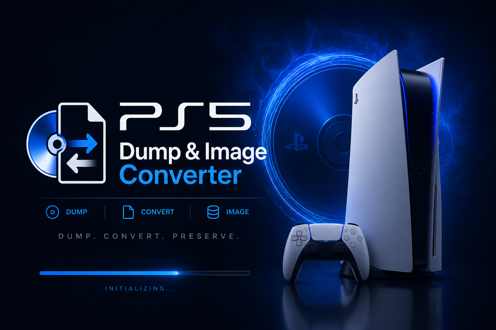
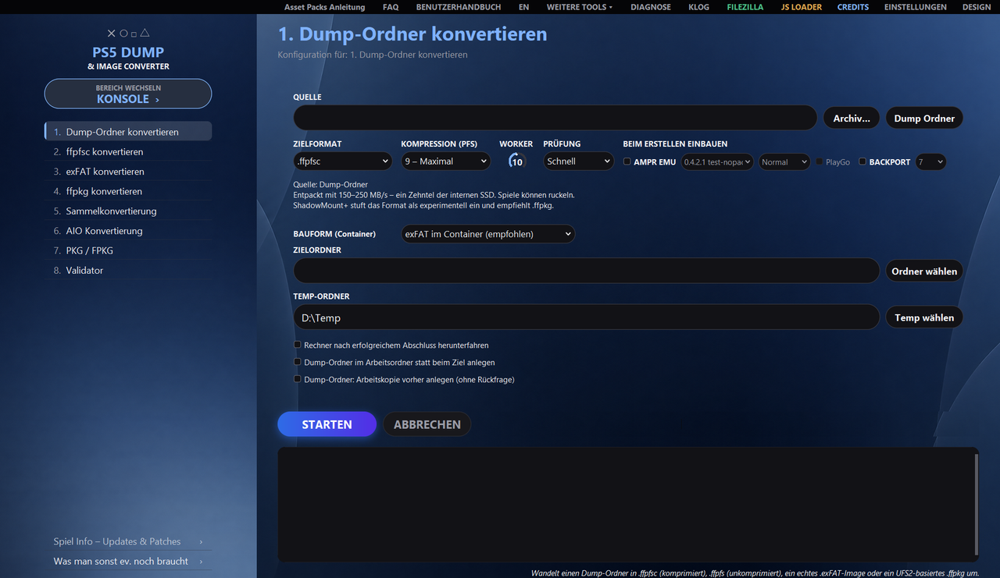
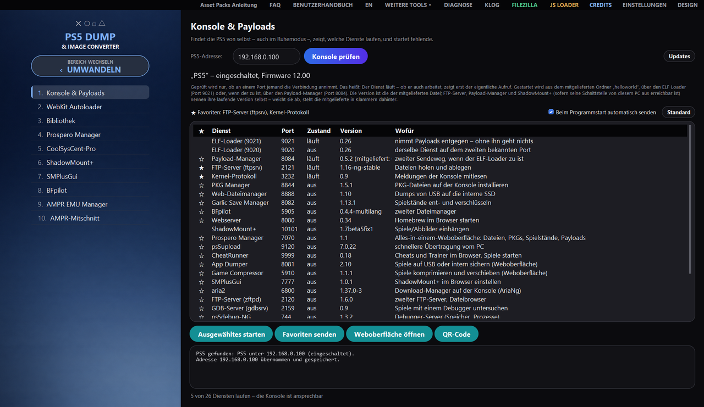
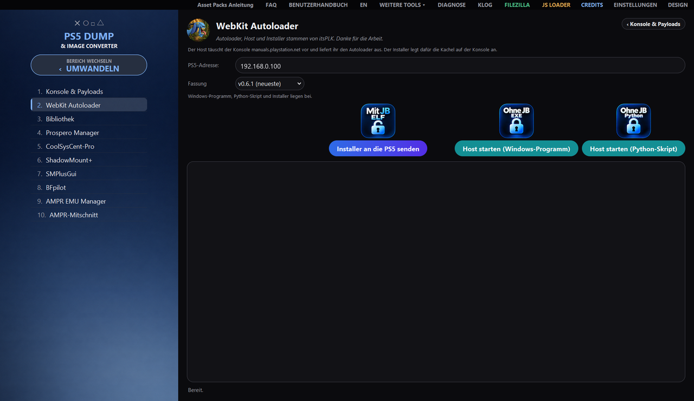
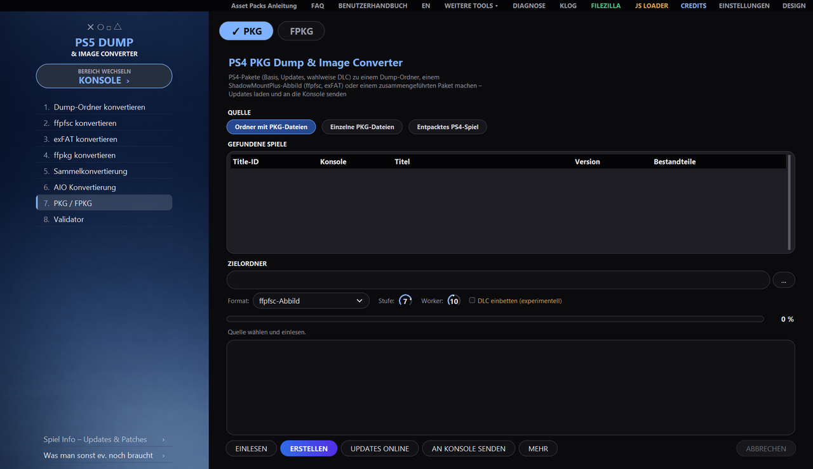
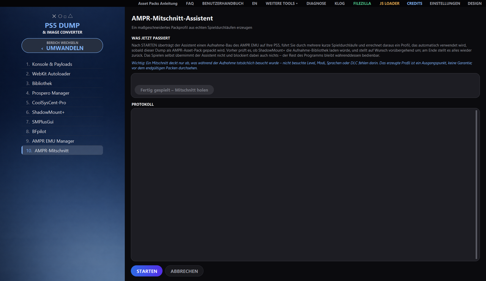

<div align="center">



# PS5 Dump & Image Converter

**PS5-Dumps und Abbilder umwandeln, entpacken und prüfen, PS4- und PS5-Pakete bauen
und die Konsole gleich mit bedienen – unter Windows, Linux und macOS.**


[Funktionen](#funktionen) ·
[Ansichten](#ansichten) ·
[Download](#download) ·
[Voraussetzungen](#voraussetzungen) ·
[Bedienung](#bedienung) ·
[Dokumentation](#dokumentation) ·
[Rechtliches](#rechtliches) ·
[Credits](#credits)



</div>

Das Programm wandelt Dump-Ordner, `.ffpfsc`, `.exfat` und echte UFS2-basierte `.ffpkg`-Dateien
ineinander um, liest und baut PS4- und PS5-Pakete, baut AMPR EMU und BACKPORT ein und bringt
Werkzeuge für die Konsole mit: Payloads senden, Weboberflächen im Programm öffnen, die Spielbibliothek
der PS5 verwalten. Alles läuft über eine grafische Oberfläche mit zwei Bereichen – **UMWANDELN** und
**KONSOLE**; jede Aufgabe gibt es auch ohne Fenster per Kommandozeile.

> [!IMPORTANT]
> Nur für **eigene, rechtmäßig erworbene** Inhalte. Piraterie und das Umgehen von Kopierschutz sind
> ausdrücklich nicht Zweck dieses Projekts – siehe [Haftungsausschluss](#haftungsausschluss).

## Funktionen

<table>
<tr>
<td width="33%" valign="top">

🔄 **Umwandeln**<br>
Dump-Ordner, `.ffpfsc`, `.exfat` und echte UFS2-`.ffpkg` in jede Richtung. Angeboten werden nur
Zielformate, die zur erkannten Quelle passen.

</td>
<td width="33%" valign="top">

🗃 **Sammeln & Exportieren**<br>
Sammelkonvertierung mehrerer Container und AIO-Konvertierung für Ordner oder Container in ein
passendes Zielformat.

</td>
<td width="33%" valign="top">

✅ **Validator**<br>
Integritätsbericht für Dump-Ordner und Container – bevor etwas auf die Konsole wandert.

</td>
</tr>
<tr>
<td valign="top">

📦 **PKG / FPKG**<br>
PS4- und PS5-Pakete lesen, entpacken, zu Abbildern bauen, Updates laden und an die Konsole senden.

</td>
<td valign="top">

🧩 **AMPR EMU & BACKPORT**<br>
Beim Erstellen einbauen, mit Asset-Packs. Für ASTRO BOT, EA Sports UFC 6 sowie Unity- und
Insomniac-Spiele liegen getestete Packprofile bei.

</td>
<td valign="top">

🎯 **AMPR-Mitschnitt**<br>
Der Assistent erzeugt aus echten Spieldurchläufen auf der PS5 ein maßgeschneidertes Packprofil.

</td>
</tr>
<tr>
<td valign="top">

🎮 **Konsole & Payloads**<br>
PS5 im Netz finden, Dienste prüfen, Payloads senden; Favoriten gehen auf Wunsch beim Programmstart
automatisch hinaus.

</td>
<td valign="top">

🌐 **Weboberflächen & Autoloader**<br>
Weboberflächen der Konsole direkt im Programm öffnen; WebKit Autoloader von itsPLK mit Versionswahl.

</td>
<td valign="top">

📚 **Bibliothek & Spiel-Info**<br>
Spielbibliothek von Rechner und PS5 mit Cover; Spiel-Info mit Updates & Patches zu jedem Titel.

</td>
</tr>
<tr>
<td valign="top">

🛠 **Werkzeuge**<br>
ShadowMount+, SMPlusGui, Prospero Manager, CoolSysCent-Pro und BFpilot erreichen Sie aus der
Seitenleiste.

</td>
<td valign="top">

⌨ **Kommandozeile**<br>
Jede Aufgabe auch ohne Fenster (`--cli`), dazu Umgebungsprüfung (`--doktor`) und Werkzeugpflege.

</td>
<td valign="top">

🖥 **Windows, Linux, macOS**<br>
Dieselbe Oberfläche und dieselben Aufgaben auf allen drei Systemen; Deutsch und Englisch.

</td>
</tr>
</table>

## Ansichten

<table>
<tr>
<td width="50%"></td>
<td width="50%"></td>
</tr>
<tr>
<td align="center">Konsole & Payloads: Dienste prüfen, Payloads und Favoriten senden</td>
<td align="center">WebKit Autoloader: Installer senden, Host starten</td>
</tr>
<tr>
<td width="50%"></td>
<td width="50%"></td>
</tr>
<tr>
<td align="center">PKG / FPKG: Pakete lesen, bauen, Updates laden</td>
<td align="center">AMPR-Mitschnitt: Packprofil aus echten Spieldurchläufen</td>
</tr>
</table>

## Download

Die fertigen Programme liegen unter
**[Releases](https://github.com/strongt1me/PS5-Dump-Image-Converter/releases/latest)**:

| System | Datei | Start |
| --- | --- | --- |
| 🪟 Windows 10/11 | `PS5_Dump_Image_Converter_vX.Y.Z.exe` | Doppelklick |
| 🐧 Linux | `PS5_Dump_Image_Converter_vX.Y.Z_linux_x86_64` | einmal `chmod +x`, dann starten |
| 🍎 macOS (Apple Silicon) | `…_macos_arm64.dmg` | `Erste Installation.command` im Abbild |
| 🍎 macOS (Intel) | `…_macos_x86_64.dmg` | `Erste Installation.command` im Abbild |

Unter macOS legt `Erste Installation.command` die App ab und entfernt die Quarantäne-Markierung.

## Voraussetzungen

- **Windows 10/11**, eine aktuelle Linux-Distribution oder **macOS 12+**
- Genug freier Speicherplatz für Quelle, Zwischenstand und Ausgabe
- **Windows:** Administratorrechte für UFS2-Abläufe (`.ffpkg`)
- **Kein OSFMount nötig:** `.exFAT`-Abbilder liest das Programm mit seinem eingebetteten exFAT-Leser, ohne
  etwas einzuhängen – auf jedem System. [OSFMount](https://www.osforensics.com/tools/mount-disk-images.html)
  ist nur der Rückfall für ungewöhnliche Abbilder unter Windows; wird er gebraucht, sagt das Programm es
  und kann ihn selbst installieren
- **Aus dem Quelltext:** Python 3.11+ und `pip`

## Bedienung

Die Seitenleiste hat zwei Bereiche, zwischen denen der Knopf **BEREICH WECHSELN** umschaltet.

<table>
<tr>
<th width="50%">UMWANDELN</th>
<th width="50%">KONSOLE</th>
</tr>
<tr>
<td valign="top">

| Nr. | Aufgabe |
| ---: | --- |
| 1 | Dump-Ordner konvertieren |
| 2 | ffpfsc konvertieren |
| 3 | exFAT konvertieren |
| 4 | ffpkg konvertieren |
| 5 | Sammelkonvertierung |
| 6 | AIO Konvertierung |
| 7 | PKG / FPKG |
| 8 | Validator |

</td>
<td valign="top">

| Nr. | Werkzeug |
| ---: | --- |
| 1 | Konsole & Payloads |
| 2 | WebKit Autoloader |
| 3 | Bibliothek |
| 4 | Prospero Manager |
| 5 | CoolSysCent-Pro |
| 6 | ShadowMount+ |
| 7 | SMPlusGui |
| 8 | BFpilot |
| 9 | AMPR EMU Manager |
| 10 | AMPR-Mitschnitt |

</td>
</tr>
</table>

Was jeder Knopf genau macht, erklärt das **[Benutzerhandbuch](BENUTZERHANDBUCH.html)**; kurze Antworten
stehen in der **[FAQ](FAQ.html)**. Im Programm öffnen beides die Knöpfe **BENUTZERHANDBUCH** und **FAQ**
oben in der Titelleiste, in der Sprache der Oberfläche.

## Dokumentation

| Dokument | Inhalt | Formate |
| --- | --- | --- |
| **Benutzerhandbuch** | Bedienung in einfacher Sprache: alle Aufgaben, die Werkzeugleiste, typische Fehler, Besonderheiten unter Linux und macOS | [HTML](BENUTZERHANDBUCH.html) · [PDF](BENUTZERHANDBUCH.pdf) |
| **FAQ** | die häufigsten Fragen kurz beantwortet | [HTML](FAQ.html) · [PDF](FAQ.pdf) |
| **FAQ (English)** | the most common questions, answered briefly | [HTML](FAQ_EN.html) · [PDF](FAQ_EN.pdf) |
| **Changelog** | was sich je Version geändert hat | [CHANGELOG.md](CHANGELOG.md) |
| **Anleitungen** | AMPR Asset Packs mit Mitschnitt-Assistent, ShadowMount+ `fakelib` | [Anleitungen/](Anleitungen) |

## Für Fortgeschrittene

<details>
<summary><b>Kommandozeile</b> – jede Aufgabe ohne Fenster</summary>

<br>

Über dieselbe geprüfte Ablauflogik wie die Oberfläche:

```bash
python PS5ImageConverter_Pro_FINAL_revised.py --cli --task 1 \
  --source "D:\Dumps\Spiel" --dest "D:\Ausgabe" --format ffpkg --yes
```

| Option | Bedeutung |
| --- | --- |
| `--cli` | aktiviert den Kommandozeilenmodus (erforderlich) |
| `--task N` | Aufgabe 1–8 |
| `--source PFAD` | Quellpfad; mehrere nur bei Aufgabe 5 |
| `--dest PFAD` | Zielordner (entfällt bei Aufgabe 8) |
| `--format …` | `folder`, `ffpfsc`, `ffpfs`, `exfat`, `ffpkg` |
| `--temp PFAD` | Arbeitsordner überschreiben |
| `--yes` | Rückfragen automatisch bestätigen |
| `--quiet` | Protokoll nicht auf stdout spiegeln |
| `--shutdown-on-success` | nach Erfolg herunterfahren |
| `--umhuellt-neu-packen` | `.exFAT`/`.ffpkg` → `.ffpfsc` mit AMPR EMU/BACKPORT: entpacken, einbauen, wieder zu `.ffpfsc` packen |
| `--umhuellt-als-ordner` | auf demselben Weg stattdessen nur den Dump-Ordner bauen |
| `--ampr-index-trotz-assets` | `ampr_emu.index` auch bei vorhandenem Asset-Pack neu bauen |
| `--ampr-originale-weglassen` | beim Asset-Pack die gepackten Originale aus der Arbeitskopie entfernen (nur nach bestandenem Konsolentest sinnvoll) |
| `--param-json-reparieren` | fehlerhafte `param.json` ohne Rückfrage reparieren |
| `--param-json-online` | Titel und Content-ID dafür im Netz nachschlagen |

Die letzten sechs entscheiden Rückfragen, die `--yes` bewusst **nicht** beantwortet: Ein Schalter für
Überschreib-Rückfragen soll nicht nebenbei den Weg wechseln, ein Asset-Pack unbrauchbar machen,
Spieldateien entfernen oder Daten ins Netz schicken.

Rückgabewerte: `0` Erfolg · `1` Fehler oder Abbruch · `2` ungültige Argumente · `3` fehlende
Administratorrechte · `4` nicht geprüft (Aufgabe 8 ohne die nötigen Rechte – kein Urteil über die Datei).

> Unter Windows fordert `--cli` **keine** Rechte an – ein neu gestarteter Prozess wäre abgekoppelt, seine
> Ausgabe erreichte den Aufrufer nie. Starten Sie die Eingabeaufforderung deshalb selbst als Administrator.

</details>

<details>
<summary><b>Umgebungsprüfung</b> – <code>--doktor</code></summary>

<br>

Läuft etwas nicht, obwohl es anderswo läuft, klappert `--doktor` die häufigen Ursachen ab und liefert ein
Ergebnis, das sich in eine Fehlermeldung kopieren lässt – ohne Netzzugriff und ohne Zugangsdaten:

```bash
python PS5ImageConverter_Pro_FINAL_revised.py --doktor "E:\Temp" "E:\Ziel"
```

Beide Ordnerangaben sind freiwillig. Geprüft werden unter anderem abgeschaltete lange Pfade, das
Dateisystem der Ordner (auf FAT32 endet jede Datei bei 4 GB), Schreibrecht und freier Platz,
widersprüchliche Paketstände, ob sich die mitgelieferten Programme überhaupt starten lassen, und ob die
Einstellungsdatei lesbar ist.

Rückgabewerte: `0` nichts zu beanstanden · `1` mindestens ein echter Fehler. Dieselben Angaben stehen im
Fenster **DIAGNOSE** im Abschnitt *Doktor*.

> Die **fertige EXE** verlangt grundsätzlich Administratorrechte – das steht in ihrem Manifest und gilt für
> jeden Aufruf, auch für `--doktor`. Öffnen Sie die Eingabeaufforderung deshalb selbst als Administrator.
> Aus dem Quelltext heraus (`python …`) läuft die Prüfung ohne erhöhte Rechte.

</details>

<details>
<summary><b>Werkzeugpflege</b> – <code>--werkzeuge-pruefen</code></summary>

<br>

`--werkzeuge-pruefen` hält die mitgelieferten Payloads gegen ihre Veröffentlichungen:

```bash
python PS5ImageConverter_Pro_FINAL_revised.py --werkzeuge-pruefen
```

Der erste Teil läuft **ohne Netz** und vergleicht nur den Ordner `helloworld/` mit der Tabelle in
`THIRD_PARTY_LICENSES.md`; er steckt auch im Diagnosebericht im Abschnitt *Werkzeugpflege*. Der zweite Teil
liest eine öffentliche Fassungsliste – das ist der **einzige** Netzzugriff dieses Laufs, und er geschieht
nur, weil Sie den Befehl gegeben haben. Mit `--offline` bleibt er weg. Rückgabewerte: `0` nichts zu tun ·
`1` Abweichung, Rückstand oder Liste nicht erreichbar.

</details>

<details>
<summary><b>Selbst bauen und testen</b></summary>

<br>

```powershell
# Windows
.\Build_EXE.ps1
```

```bash
# Linux
chmod +x Build_Linux.sh && ./Build_Linux.sh

# macOS (--dmg erzeugt zusätzlich das Abbild)
chmod +x Build_macOS.sh && ./Build_macOS.sh --dmg
```

Die Testreihe läuft mit einem **eigenen Einstellungsordner** – viele Tests drücken echte Knöpfe und
speichern dabei, und ohne Umlenkung landen diese Änderungen in den Einstellungen des Programms:

```powershell
# Windows (PowerShell)
$env:PS5CONV_KONFIGORDNER = "$env:TEMP\ps5conv_pruefung\konfig"
python -m pytest -q
```

```bash
# Linux und macOS
PS5CONV_KONFIGORDNER="${TMPDIR:-/tmp}/ps5conv_pruefung/konfig" python -m pytest -q
```

Die Tests liegen im Ordner [`tests/`](tests), die Release Notes in [`release_notes/`](release_notes).

</details>

## Plattformunterschiede

Oberfläche, alle acht Aufgaben, Kommandozeile und die Übertragung zur PS5 arbeiten überall gleich.
Unterschiede gibt es hier:

| Bereich | Linux und macOS |
| --- | --- |
| `.ffpkg` lesen und bauen | Verfügbar – UFS2Tool liegt für Windows, Linux und macOS (Intel und Apple Silicon) bei; gelesen wird über `UFS2Tool extract`, gebaut über `newfs`/`makefs`. Nur das Einhängen über den Dokan-Treiber gibt es ausschließlich unter Windows. |
| PS4 PKG Dump & Image Converter | OrbisPkgTool gibt es nur als Windows-Programm. Dort entpackt es PS4-Pakete zum Dump-Ordner und führt Basis, Update und DLC zusammen; ohne das Werkzeug bleiben ffpfsc und exFAT, die über PS4 FFPFSC direkt aus den Paketen gebaut werden. Sammlung, Einzelheiten, Update-Abfrage und Senden gehen überall. |
| OSFMount-Ersatzwege | Nicht verfügbar; die nativen MkPFS-/exFAT-Wege sind vollständig vorhanden. |
| Erhöhte Rechte | Nicht nötig. |
| Einstellungen | `~/.config/PS5ImageConverterPro/` bzw. `~/Library/Application Support/PS5ImageConverterPro/` |
| Automatische Installation von Fremdwerkzeugen | Nur Windows; FileZilla wird sonst im `PATH` gefunden. |

## Rechtliches

### Haftungsausschluss

Dieses Projekt dient dem **Sichern und Verwalten von Inhalten, die Sie rechtmäßig erworben haben**, sowie
Bildungs- und Forschungszwecken.

- Verwenden Sie es **ausschließlich** mit Software, die Ihnen gehört.
- Das Umgehen technischer Schutzmaßnahmen, das Beschaffen, Verbreiten oder Öffentlich-Zugänglichmachen
  urheberrechtlich geschützter Inhalte ist **nicht** Zweck dieses Projekts und wird nicht unterstützt.
- In vielen Ländern ist bereits das Umgehen eines Kopierschutzes verboten – auch bei eigenen Datenträgern.
  **Prüfen Sie die Rechtslage in Ihrem Land.**
- Die Nutzung erfolgt auf **eigene Verantwortung und eigenes Risiko**. Die Autoren übernehmen keine Haftung
  für Schäden, Datenverlust, defekte Geräte oder rechtliche Folgen.
- Veränderungen an einer Spielkonsole können deren Garantie erlöschen lassen und sie unbrauchbar machen.

Dieses Projekt steht in **keiner Verbindung zu Sony Interactive Entertainment** und wird von dort weder
unterstützt noch geprüft. Alle Marken gehören ihren jeweiligen Inhabern.

Sichern Sie Originaldateien vor jeder Bearbeitung separat.

### Lizenz

Das Programm selbst steht seit dem 07.10.2026 unter der
[GNU General Public License, Version 3 oder neuer (GPL-3.0-or-later)](LICENSE).
Fassungen bis einschließlich v1.9.64 wurden unter der MIT-Lizenz veröffentlicht und bleiben für ihre
Empfänger unter MIT.

```
PS5 Dump & Image Converter
Copyright (C) 2026 strongt1me

This program is free software: you can redistribute it and/or modify
it under the terms of the GNU General Public License as published by
the Free Software Foundation, either version 3 of the License, or
(at your option) any later version.

This program is distributed in the hope that it will be useful,
but WITHOUT ANY WARRANTY; without even the implied warranty of
MERCHANTABILITY or FITNESS FOR A PARTICULAR PURPOSE.  See the
GNU General Public License for more details.
```

Für die mitgelieferten Fremdkomponenten gelten deren eigene Lizenzen, manche mit eigenen Bedingungen. Sie
stehen in [THIRD_PARTY_LICENSES.md](THIRD_PARTY_LICENSES.md) und sind im Fenster **CREDITS** direkt
aufrufbar – vor einer Weiterverteilung bitte prüfen.

## Credits

- **PSBrew / Renan Barreto** ([@RenanGBarreto](https://github.com/RenanGBarreto)) – [MkPFS](https://github.com/PSBrew/MkPFS), die PFS-Engine dieses Programms
- **SvenGDK und Mitwirkende** – [UFS2Tool](https://github.com/SvenGDK/UFS2Tool) und **LibProsperoPkg**, das Werkzeug hinter „Paketkopf lesen“ in „PS4 PKG Dump & Image Converter“
- **pearlxcore** – [OrbisPkgTool](https://github.com/pearlxcore/OrbisPkgTool) (MIT), die Engine hinter „PS4 PKG Dump & Image Converter“; die Anregung zum Fenster gab das PS4 PKG Tool, aus dessen Code nichts übernommen ist
- **PS4 FFPFSC** – PS4-Pakete nach `.ffpfsc` (GPL-3.0-or-later)
- **andy-man** – [PS5 Wee Tools](https://github.com/andy-man/ps5-wee-tools), Werkzeug für den NOR-Flash der Konsole (GPL-3.0), unter WEITERE TOOLS
- **kerrdec97** – [ps5-exfat-builder](https://github.com/kerrdec97/ps5-exfat-builder), Vorarbeit und Orientierung
- **drakmor / Roman Tarasov** – [AMPR EMU](https://github.com/drakmor/ampr_emu) und die **AMPR PackTools** (GPL-3.0), Grundlage der Asset-Packs
- **danthespal** – [MkPFS.CSharp](https://github.com/danthespal/MkPFS.CSharp) (GPL-3.0), die getesteten Packprofile für ASTRO BOT, EA Sports UFC 6, Unity- und Insomniac-Spiele
- **libScePlayGo-Stub** – PS5-Homebrew-Community, meldet PlayGo-Inhalte als installiert
- **John Törnblom** – [PS5 Payload SDK](https://github.com/ps5-payload-dev/sdk); `appinst.elf` hinter „App direkt installieren“ ist von dessen Beispiel abgeleitet (GPL-3.0)
- **PS5 BackPork Kitchen**, **BestPig**, **idlesauce**, **John Törnblom**, **CyB1K** – Verfahren und Vorlagen für BACKPORT
- **PassMark Software** – OSFMount
- **Dokan-Projekt** – Windows-Dateisystemtreiber
- **PyInstaller-Projekt** – Programmbündelung

Die vollständige Danksagung – mit Bild, Werken und GitHub-Links der Entwicklerinnen und Entwickler, auch der
mitgelieferten Payloads und vieler bekannter Köpfe der Community – steht im Fenster **CREDITS** und in
[THIRD_PARTY_LICENSES.md](THIRD_PARTY_LICENSES.md).

Die Funktion **BACKPORT** setzt auf Verfahren auf, die in der Szene entwickelt und veröffentlicht wurden.
