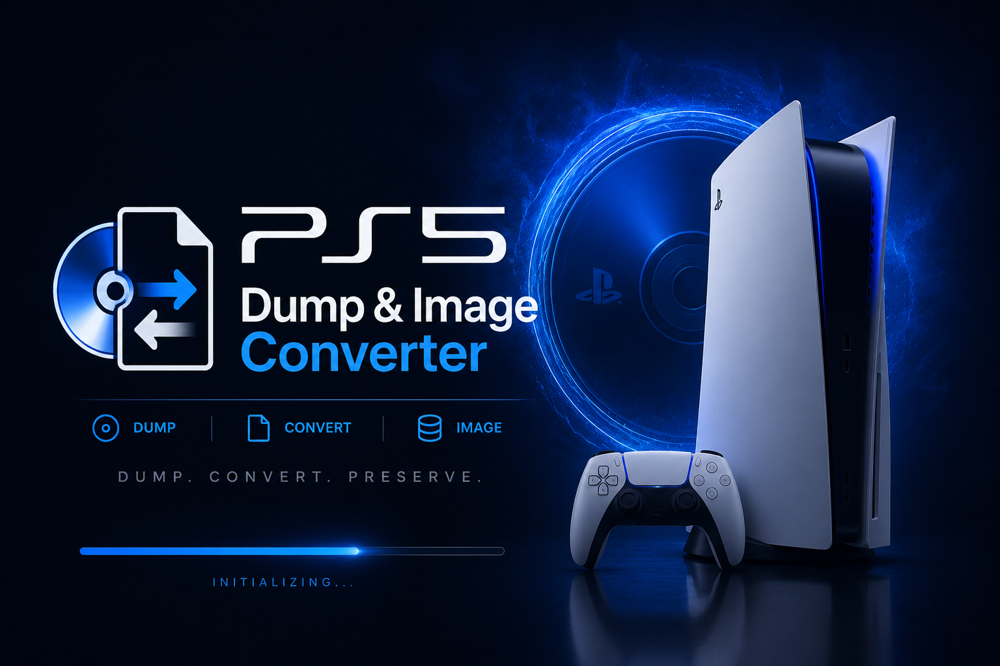
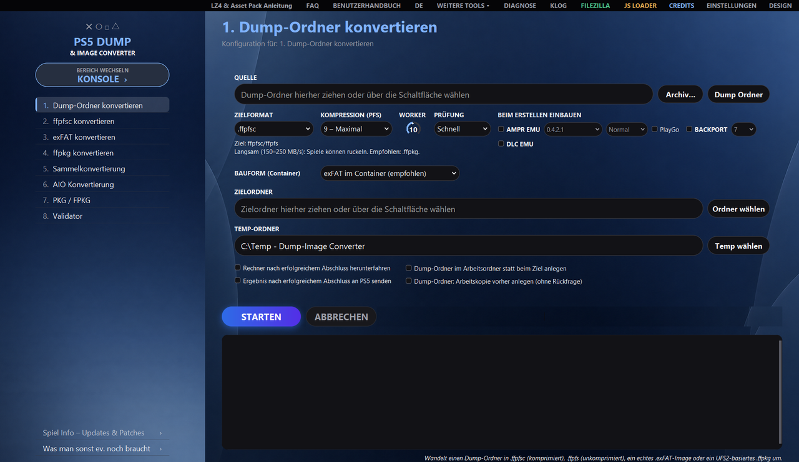
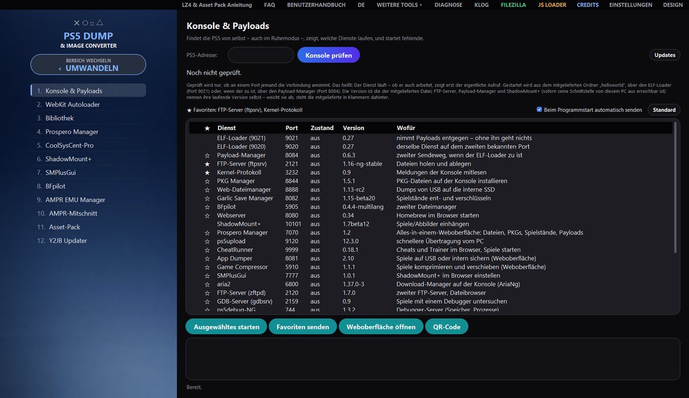
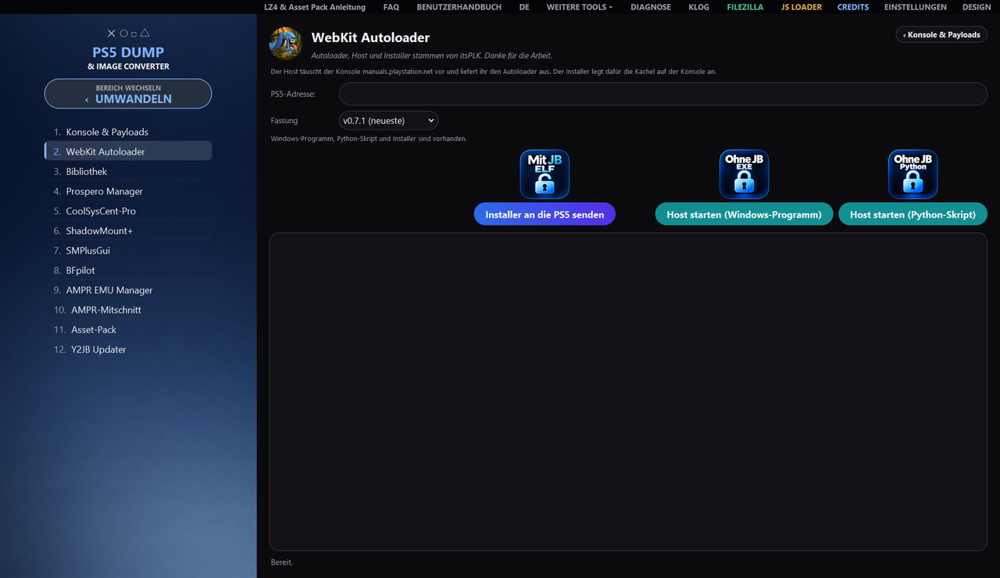
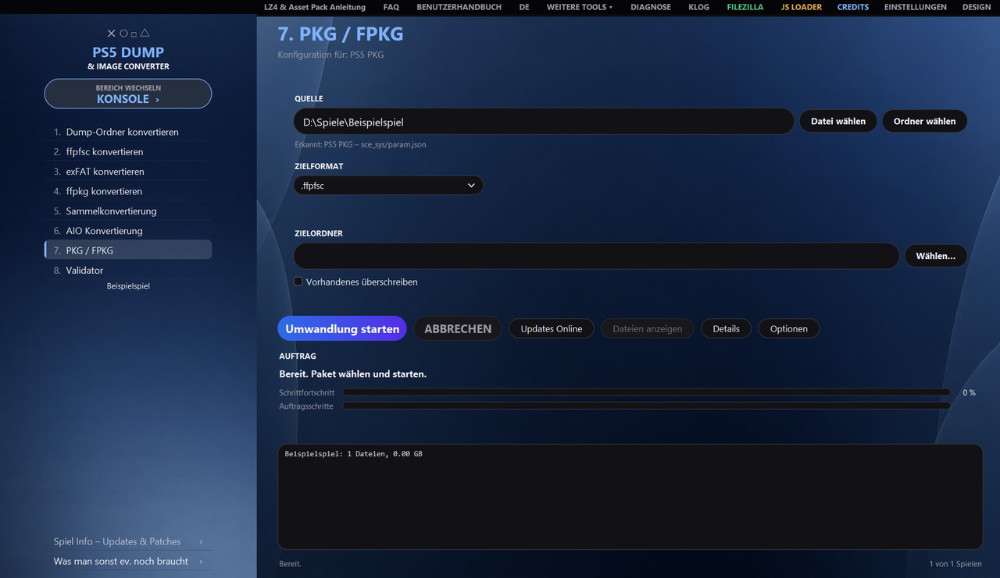
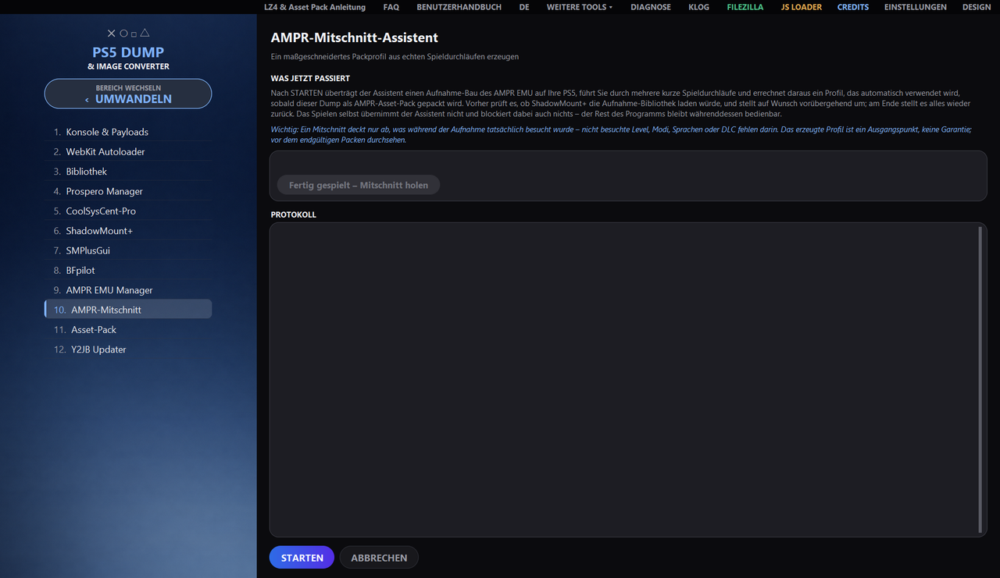

<div align="center">



# PS5 Dump & Image Converter

**Convert, unpack and verify PS5 dumps and images, build PS4 and PS5 packages,
and operate the console right alongside – on Windows, Linux and macOS.**


[Features](#features) ·
[Views](#views) ·
[Download](#download) ·
[Requirements](#requirements) ·
[Usage](#usage) ·
[Documentation](#documentation) ·
[Legal](#legal) ·
[Credits](#credits)



</div>

**Deutsch: [README.md](README.md) · English: [README_EN.md](README_EN.md) · Español: [README_ES.md](README_ES.md) · Italiano: [README_IT.md](README_IT.md) · Français: [README_FR.md](README_FR.md)**

This version is a translation of the German README.md; in case of doubt, the German version prevails (legal notices and the disclaimer included).

The program converts dump folders, `.ffpfsc`, `.exfat` and genuine UFS2-based `.ffpkg` files into one
another, reads and builds PS4 and PS5 packages, integrates AMPR EMU and BACKPORT, and comes with tools
for the console: sending payloads, opening web interfaces inside the program, and managing the PS5's game
library. Everything runs through a graphical interface with two areas – **CONVERT** and
**CONSOLE**; every task is also available without a window via the command line.

> [!IMPORTANT]
> For **your own, lawfully acquired** content only. Piracy and the circumvention of copy protection are
> expressly not the purpose of this project – see the [Disclaimer](#disclaimer).

## Features

<table>
<tr>
<td width="33%" valign="top">

🔄 **Convert**<br>
Dump folders, `.ffpfsc`, `.exfat` and genuine UFS2 `.ffpkg` in any direction, including directly from
`.zip`, `.7z` and `.rar`. Only target formats that match the detected source are offered.

</td>
<td width="33%" valign="top">

🗃 **Batch & Export**<br>
Batch conversion of multiple containers and AIO conversion for folders or containers into a
suitable target format.

</td>
<td width="33%" valign="top">

✅ **Validator**<br>
Integrity report for dump folders and containers – before anything goes onto the console.

</td>
</tr>
<tr>
<td valign="top">

📦 **PKG / FPKG**<br>
Read and unpack PS4 and PS5 packages, build them into images, download updates and send them to the console.

</td>
<td valign="top">

🧩 **AMPR EMU & BACKPORT**<br>
Integrate while creating, with asset packs (LZ4, and for AMPR EMU NG also zstd with custom TOML rules). Tested pack profiles are included for ASTRO BOT, EA Sports UFC 6, and Unity and
Insomniac games.

</td>
<td valign="top">

🎯 **AMPR trace**<br>
The wizard creates a tailored pack profile from real play sessions on the PS5.

</td>
</tr>
<tr>
<td valign="top">

🎮 **Console & payloads**<br>
Find the PS5 on the network, check services, send payloads; favorites can be sent automatically
at program start if you want.

</td>
<td valign="top">

🌐 **Web interfaces & autoloader**<br>
Open the console's web interfaces directly in the program; WebKit Autoloader by itsPLK with version selection.

</td>
<td valign="top">

📚 **Library & Game Info**<br>
Game library of the computer and the PS5 with covers; Game Info with updates & patches for every title.

</td>
</tr>
<tr>
<td valign="top">

🛠 **Tools**<br>
ShadowMount+, SMPlusGui, Prospero Manager, CoolSysCent-Pro and BFpilot are reachable from the
sidebar. Under MORE TOOLS, EDIT IMAGE changes individual files of an image
(unpack, replace, rename, delete, repack).

</td>
<td valign="top">

⌨ **Command line**<br>
Every task also without a window (`--cli`), plus environment check (`--doktor`) and tool upkeep.

</td>
<td valign="top">

🖥 **Windows, Linux, macOS**<br>
The same interface and the same tasks on all three systems; German, English, Spanish, Italian and French.

</td>
</tr>
</table>

## Views

<table>
<tr>
<td width="50%"></td>
<td width="50%"></td>
</tr>
<tr>
<td align="center">Console & payloads: check services, send payloads and favorites</td>
<td align="center">WebKit Autoloader: send installer, start host</td>
</tr>
<tr>
<td width="50%"></td>
<td width="50%"></td>
</tr>
<tr>
<td align="center">PKG / FPKG: read and build packages, download updates</td>
<td align="center">AMPR trace: pack profile from real play sessions</td>
</tr>
</table>

## Download

The ready-to-use programs are available under
**[Releases](https://github.com/strongt1me/PS5-Dump-Image-Converter/releases/latest)**:

| System | File | Start |
| --- | --- | --- |
| 🪟 Windows 10/11 | `PS5_Dump_Image_Converter_vX.Y.Z.exe` | double-click |
| 🐧 Linux | `PS5_Dump_Image_Converter_vX.Y.Z_linux_x86_64` | run `chmod +x` once, then start |
| 🍎 macOS (Apple Silicon) | `…_macos_arm64.dmg` | `Erste Installation.command` in the image |
| 🍎 macOS (Intel) | `…_macos_x86_64.dmg` | `Erste Installation.command` in the image |

On macOS, `Erste Installation.command` places the app and removes the quarantine flag.

## Requirements

- **Windows 10/11**, a current Linux distribution, or **macOS 12+**
- Enough free disk space for source, intermediate state and output
- **Windows:** administrator rights for UFS2 workflows (`.ffpkg`)
- **OSFMount not required:** the program reads `.exFAT` images with its embedded exFAT reader, without
  mounting anything – on every system. [OSFMount](https://www.osforensics.com/tools/mount-disk-images.html)
  is only the fallback for unusual images on Windows; if it is needed, the program says so
  and can install it itself
- **From source:** Python 3.11+ and `pip`

## Usage

The sidebar has two areas, which the **SWITCH AREA** button toggles between.

<table>
<tr>
<th width="50%">CONVERT</th>
<th width="50%">CONSOLE</th>
</tr>
<tr>
<td valign="top">

| No. | Task |
| ---: | --- |
| 1 | Convert dump folder |
| 2 | Convert ffpfsc |
| 3 | Convert exFAT |
| 4 | Convert ffpkg |
| 5 | Batch conversion |
| 6 | AIO conversion |
| 7 | PKG / FPKG |
| 8 | Validator |

</td>
<td valign="top">

| No. | Tool |
| ---: | --- |
| 1 | Console & payloads |
| 2 | WebKit Autoloader |
| 3 | Library |
| 4 | Prospero Manager |
| 5 | CoolSysCent-Pro |
| 6 | ShadowMount+ |
| 7 | SMPlusGui |
| 8 | BFpilot |
| 9 | AMPR EMU Manager |
| 10 | AMPR trace |

</td>
</tr>
</table>

What each button does exactly is explained in the **[User manual](BENUTZERHANDBUCH_EN.html)**; short answers
are in the **[FAQ](FAQ_EN.html)**. Inside the program, the **USER MANUAL** and **FAQ** buttons
at the top of the title bar open both, in the language of the interface.

## Documentation

| Document | Contents | Formats |
| --- | --- | --- |
| **User manual** | Operation in plain language: all tasks, the toolbar, typical errors, peculiarities on Linux and macOS | [HTML](BENUTZERHANDBUCH_EN.html) · [PDF](BENUTZERHANDBUCH_EN.pdf) |
| **FAQ (German)** | the most common questions, answered briefly | [HTML](FAQ.html) · [PDF](FAQ.pdf) |
| **FAQ (English)** | the most common questions, answered briefly | [HTML](FAQ_EN.html) · [PDF](FAQ_EN.pdf) |
| **FAQ (Spanish)** | the most common questions, answered briefly | [HTML](FAQ_ES.html) · [PDF](FAQ_ES.pdf) |
| **FAQ (Italian)** | the most common questions, answered briefly | [HTML](FAQ_IT.html) · [PDF](FAQ_IT.pdf) |
| **FAQ (French)** | the most common questions, answered briefly | [HTML](FAQ_FR.html) · [PDF](FAQ_FR.pdf) |
| **Changelog** | what changed in each version | [CHANGELOG.md](CHANGELOG.md) |
| **Guides** | AMPR asset packs with the trace wizard, ShadowMount+ `fakelib` | [Anleitungen/](Anleitungen) |

## Advanced

<details>
<summary><b>Command line</b> – every task without a window</summary>

<br>

Uses the same verified workflow logic as the interface:

```bash
python PS5ImageConverter_Pro_FINAL_revised.py --cli --task 1 \
  --source "D:\Dumps\Spiel" --dest "D:\Ausgabe" --format ffpkg --yes
```

| Option | Meaning |
| --- | --- |
| `--cli` | enables command-line mode (required) |
| `--task N` | task 1–8 |
| `--source PATH` | source path; multiple only for task 5 |
| `--dest PATH` | destination folder (not used for task 8) |
| `--format …` | `folder`, `ffpfsc`, `ffpfs`, `exfat`, `ffpkg` |
| `--temp PATH` | override the working folder |
| `--yes` | confirm prompts automatically |
| `--quiet` | do not mirror the log to stdout |
| `--shutdown-on-success` | shut down after success |
| `--umhuellt-neu-packen` | `.exFAT`/`.ffpkg` → `.ffpfsc` with AMPR EMU/BACKPORT: unpack, integrate, repack to `.ffpfsc` |
| `--umhuellt-als-ordner` | build only the dump folder along the same path instead |
| `--ampr-index-trotz-assets` | rebuild `ampr_emu.index` even if an asset pack is present |
| `--ampr-originale-weglassen` | for the asset pack, remove the packed originals from the working copy (only sensible after a passed console test; with AMPR EMU NG and zstd always, without asking) |
| `--param-json-reparieren` | repair a faulty `param.json` without prompting |
| `--param-json-online` | look up title and content ID online for that purpose |

The last six decide prompts that `--yes` deliberately does **not** answer: a switch for
overwrite prompts should not incidentally change the path, render an asset pack unusable,
remove game files or send data over the network.

Exit codes: `0` success · `1` error or abort · `2` invalid arguments · `3` missing
administrator rights · `4` not checked (task 8 without the required rights – no verdict on the file).

> On Windows, `--cli` does **not** request elevated rights – a newly started process would be detached, and its
> output would never reach the caller. Therefore start the Command Prompt as administrator yourself.

</details>

<details>
<summary><b>Environment check</b> – <code>--doktor</code></summary>

<br>

If something does not work although it works elsewhere, `--doktor` goes through the common causes and delivers a
result that can be copied into an error report – without network access and without credentials:

```bash
python PS5ImageConverter_Pro_FINAL_revised.py --doktor "E:\Temp" "E:\Ziel"
```

Both folder arguments are optional. Among other things, it checks for disabled long paths, the
file system of the folders (on FAT32 every file ends at 4 GB), write permission and free space,
conflicting package versions, whether the bundled programs can actually be started, and whether the
settings file is readable.

Exit codes: `0` nothing to complain about · `1` at least one real error. The same information is in the
**DIAGNOSTICS** window in the *Doctor* section.

> The **finished EXE** always requires administrator rights – this is in its manifest and applies to
> every invocation, including `--doktor`. Therefore open the Command Prompt as administrator yourself.
> When run from source (`python …`), the check runs without elevated rights.

</details>

<details>
<summary><b>Tool upkeep</b> – <code>--werkzeuge-pruefen</code></summary>

<br>

`--werkzeuge-pruefen` checks the bundled payloads against their releases:

```bash
python PS5ImageConverter_Pro_FINAL_revised.py --werkzeuge-pruefen
```

The first part runs **without a network** and only compares the `helloworld/` folder with the table in
`THIRD_PARTY_LICENSES.md`; it is also part of the diagnostics report in the *Tool upkeep* section. The second part
reads a public version list – this is the **only** network access of this run, and it happens
only because you issued the command. With `--offline` it is skipped. Exit codes: `0` nothing to do ·
`1` deviation, backlog or list unreachable.

</details>

<details>
<summary><b>Building and testing yourself</b></summary>

<br>

```powershell
# Windows
.\Build_EXE.ps1
```

```bash
# Linux
chmod +x Build_Linux.sh && ./Build_Linux.sh

# macOS (--dmg additionally creates the image)
chmod +x Build_macOS.sh && ./Build_macOS.sh --dmg
```

The test suite runs with a **separate settings folder** – many tests press real buttons and
save in the process, and without redirection these changes would end up in the program's settings:

```powershell
# Windows (PowerShell)
$env:PS5CONV_KONFIGORDNER = "$env:TEMP\ps5conv_pruefung\konfig"
python -m pytest -q
```

```bash
# Linux and macOS
PS5CONV_KONFIGORDNER="${TMPDIR:-/tmp}/ps5conv_pruefung/konfig" python -m pytest -q
```

The tests are in the [`tests/`](tests) folder, the release notes in [`release_notes/`](release_notes).

</details>

## Platform differences

The interface, all eight tasks, the command line and the transfer to the PS5 work the same everywhere.
Differences are here:

| Area | Linux and macOS |
| --- | --- |
| Reading and building `.ffpkg` | Available – UFS2Tool is bundled for Windows, Linux and macOS (Intel and Apple Silicon); reading is done via `UFS2Tool extract`, building via `newfs`/`makefs`. Only mounting via the Dokan driver exists exclusively on Windows. |
| PS4 PKG Dump & Image Converter | OrbisPkgTool exists only as a Windows program. There it unpacks PS4 packages into the dump folder and merges base, update and DLC; without that tool, ffpfsc and exFAT remain available, built directly from the packages via PS4 FFPFSC. Collection, details, update lookup and sending work everywhere. |
| OSFMount substitute paths | Not available; the native MkPFS/exFAT paths are fully present. |
| Elevated rights | Not required. |
| Settings | `~/.config/PS5ImageConverterPro/` or `~/Library/Application Support/PS5ImageConverterPro/` |
| Automatic installation of third-party tools | Windows only; otherwise FileZilla is found on the `PATH`. |

## Legal

### Disclaimer

This project serves the **backup and management of content that you have lawfully acquired**, as well as
educational and research purposes.

- Use it **exclusively** with software that you own.
- Circumventing technical protection measures, and obtaining, distributing or making publicly available
  copyrighted content, is **not** the purpose of this project and is not supported.
- In many countries, even circumventing copy protection is prohibited – including on your own media.
  **Check the legal situation in your country.**
- Use is at **your own responsibility and risk**. The authors accept no liability
  for damage, data loss, defective devices or legal consequences.
- Modifications to a game console may void its warranty and render it unusable.

This project has **no affiliation with Sony Interactive Entertainment** and is neither
supported nor reviewed by them. All trademarks belong to their respective owners.

Back up original files separately before any processing.

### License

The program itself has been licensed since 07.10.2026 under the
[GNU General Public License, version 3 or later (GPL-3.0-or-later)](LICENSE).
Versions up to and including v1.9.64 were released under the MIT License and remain under MIT
for their recipients.

```
PS5 Dump & Image Converter
Copyright (C) 2026 strongt1me

This program is free software: you can redistribute it and/or modify
it under the terms of the GNU General Public License as published by
the Free Software Foundation, either version 3 of the License, or
(at your option) any later version.

This program is distributed in the hope that it will be useful,
but WITHOUT ANY WARRANTY; without even the implied warranty of
MERCHANTABILITY or FITNESS FOR A PARTICULAR PURPOSE.  See the
GNU General Public License for more details.
```

The bundled third-party components are subject to their own licenses, some with their own terms. They
are listed in [THIRD_PARTY_LICENSES.md](THIRD_PARTY_LICENSES.md) and can be opened directly in the **CREDITS**
window – please review them before redistribution.

## Credits

- **PSBrew / Renan Barreto** ([@RenanGBarreto](https://github.com/RenanGBarreto)) – [MkPFS](https://github.com/PSBrew/MkPFS), the PFS engine of this program
- **SvenGDK and contributors** – [UFS2Tool](https://github.com/SvenGDK/UFS2Tool) and **LibProsperoPkg**, the tool behind “Read package header” in “PS4 PKG Dump & Image Converter”
- **pearlxcore** – [OrbisPkgTool](https://github.com/pearlxcore/OrbisPkgTool) (MIT), the engine behind “PS4 PKG Dump & Image Converter”; the idea for the window came from the PS4 PKG Tool, from whose code nothing was taken
- **PS4 FFPFSC** – PS4 packages to `.ffpfsc` (GPL-3.0-or-later)
- **andy-man** – [PS5 Wee Tools](https://github.com/andy-man/ps5-wee-tools), a tool for the console's NOR flash (GPL-3.0), under MORE TOOLS
- **kerrdec97** – [ps5-exfat-builder](https://github.com/kerrdec97/ps5-exfat-builder), groundwork and guidance
- **drakmor / Roman Tarasov** – [AMPR EMU](https://github.com/drakmor/ampr_emu) and the **AMPR PackTools** (GPL-3.0), the basis of the asset packs
- **danthespal** – [MkPFS.CSharp](https://github.com/danthespal/MkPFS.CSharp) (GPL-3.0), the tested pack profiles for ASTRO BOT, EA Sports UFC 6, and Unity and Insomniac games
- **libScePlayGo stub** – PS5 homebrew community, reports PlayGo content as installed
- **John Törnblom** – [PS5 Payload SDK](https://github.com/ps5-payload-dev/sdk); `appinst.elf` behind “Install app directly” is derived from its example (GPL-3.0)
- **PS5 BackPork Kitchen**, **BestPig**, **idlesauce**, **John Törnblom**, **CyB1K** – methods and templates for BACKPORT
- **PassMark Software** – OSFMount
- **Dokan project** – Windows file system driver
- **PyInstaller project** – program bundling

The complete acknowledgments – with picture, works and GitHub links of the developers, including those of the
bundled payloads and many well-known figures of the community – are in the **CREDITS** window and in
[THIRD_PARTY_LICENSES.md](THIRD_PARTY_LICENSES.md).

The **BACKPORT** feature builds on methods that were developed and published in the scene.
