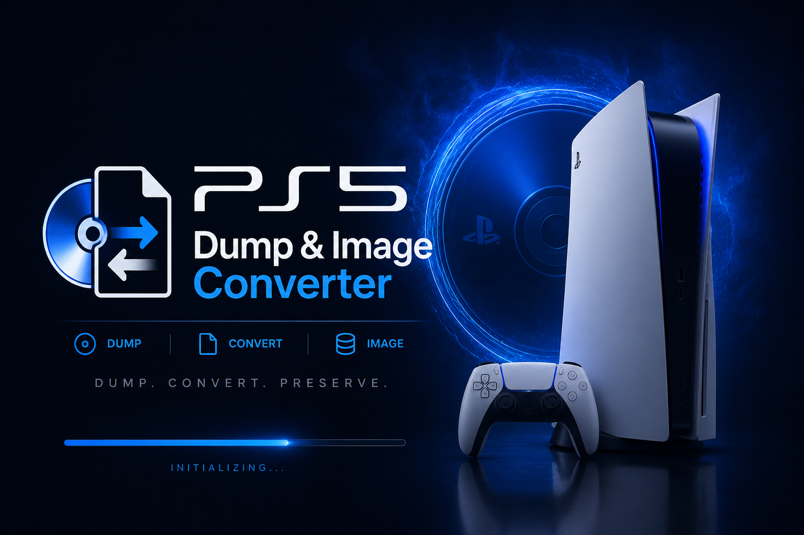
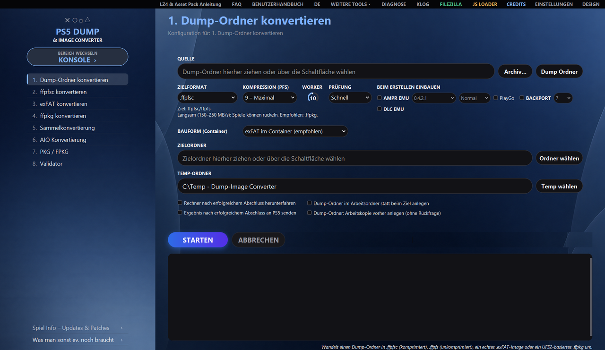
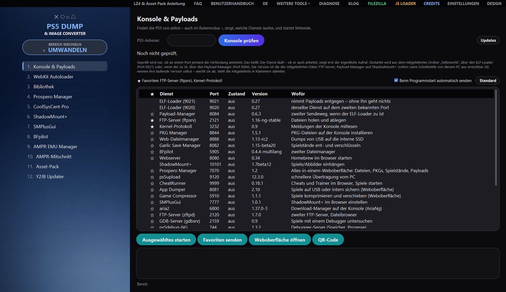
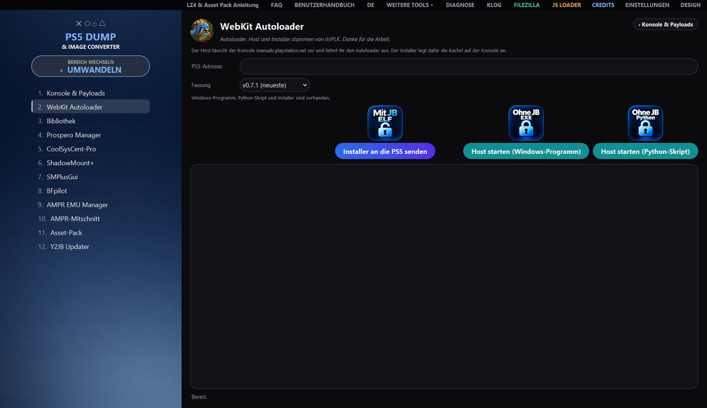
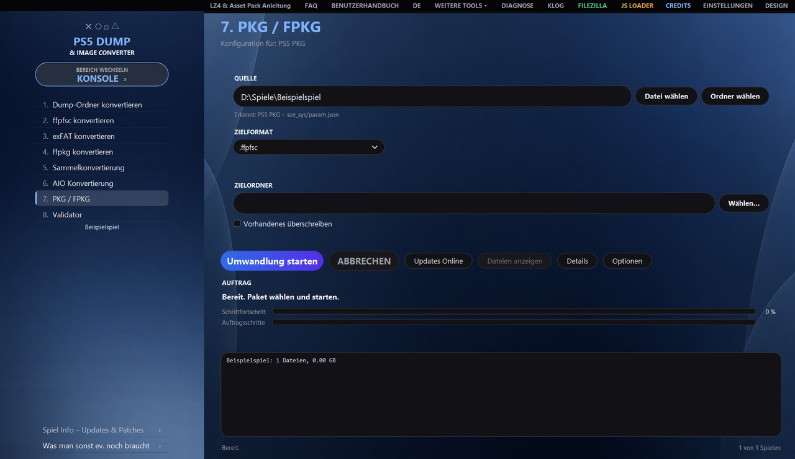
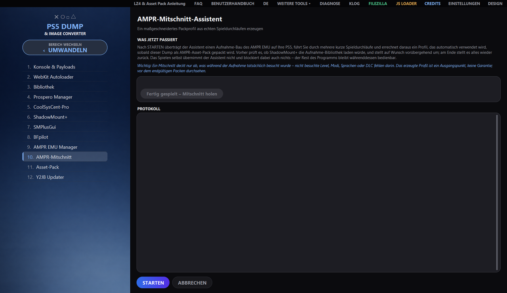

<div align="center">



# PS5 Dump & Image Converter

**Convertir, extraer y comprobar dumps e imágenes de PS5, construir paquetes de PS4 y PS5
y manejar la consola desde el mismo programa, en Windows, Linux y macOS.**


[Funciones](#funciones) ·
[Vistas](#vistas) ·
[Descarga](#descarga) ·
[Requisitos](#requisitos) ·
[Manejo](#manejo) ·
[Documentación](#documentación) ·
[Aviso legal](#aviso-legal) ·
[Créditos](#créditos)



</div>

**Deutsch: [README.md](README.md) · English: [README_EN.md](README_EN.md) · Español: [README_ES.md](README_ES.md) · Italiano: [README_IT.md](README_IT.md) · Français: [README_FR.md](README_FR.md)**

Esta versión es una traducción del README.md alemán; en caso de duda prevalece la versión alemana (incluidos los aspectos legales y la exención de responsabilidad).

El programa convierte entre sí carpetas de dump, `.ffpfsc`, `.exfat` y archivos `.ffpkg` genuinos basados en UFS2,
lee y construye paquetes de PS4 y PS5, integra AMPR EMU y BACKPORT e incorpora herramientas para la consola:
enviar payloads, abrir interfaces web dentro del programa y gestionar la biblioteca de juegos
de la PS5. Todo funciona mediante una interfaz gráfica con dos áreas, **CONVERTIR** y
**CONSOLA**; cada tarea también está disponible sin ventana, mediante la línea de comandos.

> [!IMPORTANT]
> Solo para contenidos **propios y adquiridos legalmente**. La piratería y la elusión de protecciones contra copia
> no son, expresamente, el propósito de este proyecto; véase [Exención de responsabilidad](#exención-de-responsabilidad).

## Funciones

<table>
<tr>
<td width="33%" valign="top">

🔄 **Convertir**<br>
Carpetas de dump, `.ffpfsc`, `.exfat` y `.ffpkg` UFS2 genuinos en cualquier dirección, también directamente desde
`.zip`, `.7z` y `.rar`. Solo se ofrecen los formatos de destino compatibles con el origen detectado.

</td>
<td width="33%" valign="top">

🗃 **Lotes y exportación**<br>
Conversión por lotes de varios contenedores y conversión AIO de carpetas o contenedores a un
formato de destino adecuado.

</td>
<td width="33%" valign="top">

✅ **Validador**<br>
Informe de integridad de carpetas de dump y contenedores, antes de que algo pase a la consola.

</td>
</tr>
<tr>
<td valign="top">

📦 **PKG / FPKG**<br>
Leer y extraer paquetes de PS4 y PS5, construirlos como imágenes, descargar actualizaciones y enviarlos a la consola.

</td>
<td valign="top">

🧩 **AMPR EMU y BACKPORT**<br>
Integración al crear, con Asset Packs (LZ4; para AMPR EMU NG también zstd con reglas TOML propias). Para ASTRO BOT, EA Sports UFC 6 y juegos de Unity e
Insomniac se incluyen perfiles de empaquetado probados.

</td>
<td valign="top">

🎯 **Captura AMPR**<br>
El asistente genera un perfil de empaquetado a medida a partir de partidas reales en la PS5.

</td>
</tr>
<tr>
<td valign="top">

🎮 **Consola y payloads**<br>
Encontrar la PS5 en la red, comprobar servicios, enviar payloads; si se desea, los favoritos se envían
automáticamente al iniciar el programa.

</td>
<td valign="top">

🌐 **Interfaces web y Autoloader**<br>
Abrir las interfaces web de la consola directamente en el programa; WebKit Autoloader de itsPLK con selección de versión.

</td>
<td valign="top">

📚 **Biblioteca e info del juego**<br>
Biblioteca de juegos del equipo y de la PS5 con carátula; info del juego con actualizaciones y parches para cada título.

</td>
</tr>
<tr>
<td valign="top">

🛠 **Herramientas**<br>
ShadowMount+, SMPlusGui, Prospero Manager, CoolSysCent-Pro y BFpilot son accesibles desde la
barra lateral. En MÁS HERRAMIENTAS, EDITAR IMAGEN modifica archivos individuales de una imagen
(extraer, sustituir, renombrar, eliminar, volver a empaquetar).

</td>
<td valign="top">

⌨ **Línea de comandos**<br>
Cada tarea también sin ventana (`--cli`), además de comprobación del entorno (`--doktor`) y mantenimiento de herramientas.

</td>
<td valign="top">

🖥 **Windows, Linux, macOS**<br>
La misma interfaz y las mismas tareas en los tres sistemas; alemán, inglés, español, italiano y francés.

</td>
</tr>
</table>

## Vistas

<table>
<tr>
<td width="50%"></td>
<td width="50%"></td>
</tr>
<tr>
<td align="center">Consola y payloads: comprobar servicios, enviar payloads y favoritos</td>
<td align="center">WebKit Autoloader: enviar el instalador, iniciar el host</td>
</tr>
<tr>
<td width="50%"></td>
<td width="50%"></td>
</tr>
<tr>
<td align="center">PKG / FPKG: leer y construir paquetes, descargar actualizaciones</td>
<td align="center">Captura AMPR: perfil de empaquetado a partir de partidas reales</td>
</tr>
</table>

## Descarga

Los programas ya compilados están en
**[Releases](https://github.com/strongt1me/PS5-Dump-Image-Converter/releases/latest)**:

| Sistema | Archivo | Inicio |
| --- | --- | --- |
| 🪟 Windows 10/11 | `PS5_Dump_Image_Converter_vX.Y.Z.exe` | doble clic |
| 🐧 Linux | `PS5_Dump_Image_Converter_vX.Y.Z_linux_x86_64` | ejecutar una vez `chmod +x` y después iniciar |
| 🍎 macOS (Apple Silicon) | `…_macos_arm64.dmg` | `Erste Installation.command` en la imagen |
| 🍎 macOS (Intel) | `…_macos_x86_64.dmg` | `Erste Installation.command` en la imagen |

En macOS, `Erste Installation.command` coloca la app en su sitio y elimina la marca de cuarentena.

## Requisitos

- **Windows 10/11**, una distribución de Linux actual o **macOS 12+**
- Espacio libre suficiente para el origen, el estado intermedio y la salida
- **Windows:** derechos de administrador para los procesos con UFS2 (`.ffpkg`)
- **No hace falta OSFMount:** las imágenes `.exFAT` las lee el programa con su lector exFAT integrado, sin
  montar nada, en cualquier sistema. [OSFMount](https://www.osforensics.com/tools/mount-disk-images.html)
  es solo la alternativa para imágenes poco habituales en Windows; si hace falta, el programa lo indica
  y puede instalarlo por sí mismo
- **Desde el código fuente:** Python 3.11+ y `pip`

## Manejo

La barra lateral tiene dos áreas, entre las que alterna el botón **CAMBIAR DE ÁREA**.

<table>
<tr>
<th width="50%">CONVERTIR</th>
<th width="50%">CONSOLA</th>
</tr>
<tr>
<td valign="top">

| N.º | Tarea |
| ---: | --- |
| 1 | Convertir carpeta de dump |
| 2 | Convertir ffpfsc |
| 3 | Convertir exFAT |
| 4 | Convertir ffpkg |
| 5 | Conversión por lotes |
| 6 | Conversión AIO |
| 7 | PKG / FPKG |
| 8 | Validador |

</td>
<td valign="top">

| N.º | Herramienta |
| ---: | --- |
| 1 | Consola y payloads |
| 2 | WebKit Autoloader |
| 3 | Biblioteca |
| 4 | Prospero Manager |
| 5 | CoolSysCent-Pro |
| 6 | ShadowMount+ |
| 7 | SMPlusGui |
| 8 | BFpilot |
| 9 | AMPR EMU Manager |
| 10 | Captura AMPR |

</td>
</tr>
</table>

El **[Manual de usuario](BENUTZERHANDBUCH_ES.html)** explica con exactitud qué hace cada botón; las respuestas breves
están en las **[FAQ](FAQ_ES.html)**. Dentro del programa, ambos se abren con los botones **MANUAL DE USUARIO** y **FAQ**
de la barra de título, en el idioma de la interfaz.

## Documentación

| Documento | Contenido | Formatos |
| --- | --- | --- |
| **Manual de usuario** | Manejo en lenguaje sencillo: todas las tareas, la barra de herramientas, errores típicos, particularidades en Linux y macOS | [HTML](BENUTZERHANDBUCH_ES.html) · [PDF](BENUTZERHANDBUCH_ES.pdf) |
| **FAQ (Deutsch)** | las preguntas más frecuentes, con respuestas breves | [HTML](FAQ.html) · [PDF](FAQ.pdf) |
| **FAQ (English)** | the most common questions, answered briefly | [HTML](FAQ_EN.html) · [PDF](FAQ_EN.pdf) |
| **README (EN · ES · IT · FR)** | esta página en otros cuatro idiomas | [English](README_EN.md) · [Español](README_ES.md) · [Italiano](README_IT.md) · [Français](README_FR.md) |
| **FAQ (Español)** | las preguntas más frecuentes, con respuestas breves | [HTML](FAQ_ES.html) · [PDF](FAQ_ES.pdf) |
| **FAQ (Italiano)** | le domande più frequenti, con risposte brevi | [HTML](FAQ_IT.html) · [PDF](FAQ_IT.pdf) |
| **FAQ (Français)** | les questions les plus fréquentes, avec des réponses brèves | [HTML](FAQ_FR.html) · [PDF](FAQ_FR.pdf) |
| **Changelog** | qué ha cambiado en cada versión | [CHANGELOG.md](CHANGELOG.md) |
| **Guías** | AMPR Asset Packs con asistente de captura, `fakelib` de ShadowMount+ | [Anleitungen/](Anleitungen) |

## Para usuarios avanzados

<details>
<summary><b>Línea de comandos</b> – cada tarea sin ventana</summary>

<br>

Con la misma lógica de ejecución comprobada que la interfaz:

```bash
python PS5ImageConverter_Pro_FINAL_revised.py --cli --task 1 \
  --source "D:\Dumps\Spiel" --dest "D:\Ausgabe" --format ffpkg --yes
```

| Opción | Significado |
| --- | --- |
| `--cli` | activa el modo de línea de comandos (obligatorio) |
| `--task N` | tarea 1–8 |
| `--source PFAD` | ruta de origen; varias solo en la tarea 5 |
| `--dest PFAD` | carpeta de destino (no se aplica en la tarea 8) |
| `--format …` | `folder`, `ffpfsc`, `ffpfs`, `exfat`, `ffpkg` |
| `--temp PFAD` | sustituir la carpeta de trabajo |
| `--yes` | confirmar automáticamente las consultas |
| `--quiet` | no reflejar el registro en stdout |
| `--shutdown-on-success` | apagar el equipo tras completarse con éxito |
| `--umhuellt-neu-packen` | `.exFAT`/`.ffpkg` → `.ffpfsc` con AMPR EMU/BACKPORT: extraer, integrar y volver a empaquetar como `.ffpfsc` |
| `--umhuellt-als-ordner` | por el mismo camino, construir en su lugar solo la carpeta de dump |
| `--ampr-index-trotz-assets` | reconstruir `ampr_emu.index` incluso si ya existe un Asset Pack |
| `--ampr-originale-weglassen` | con el Asset Pack, quitar de la copia de trabajo los originales empaquetados (solo tiene sentido tras superar la prueba en la consola; con AMPR EMU NG y zstd siempre, sin preguntar) |
| `--param-json-reparieren` | reparar sin consulta un `param.json` defectuoso |
| `--param-json-online` | buscar en la red el título y el Content-ID para ello |

Los últimos seis deciden consultas que `--yes` deliberadamente **no** responde: un interruptor para las
consultas de sobrescritura no debe, de paso, cambiar el camino, inutilizar un Asset Pack,
eliminar archivos del juego ni enviar datos a la red.

Códigos de salida: `0` éxito · `1` error o cancelación · `2` argumentos no válidos · `3` faltan
derechos de administrador · `4` no comprobado (tarea 8 sin los derechos necesarios; no es un veredicto sobre el archivo).

> En Windows, `--cli` **no** solicita derechos: un proceso reiniciado quedaría desacoplado y su
> salida no llegaría nunca a quien lo invoca. Por ello, abrir el símbolo del sistema manualmente como administrador.

</details>

<details>
<summary><b>Comprobación del entorno</b> – <code>--doktor</code></summary>

<br>

Si algo no funciona aunque funcione en otro sitio, `--doktor` revisa las causas habituales y entrega un
resultado que se puede copiar en un mensaje de error, sin acceso a la red y sin credenciales:

```bash
python PS5ImageConverter_Pro_FINAL_revised.py --doktor "E:\Temp" "E:\Ziel"
```

Ambas indicaciones de carpeta son opcionales. Se comprueban, entre otras cosas, las rutas largas desactivadas, el
sistema de archivos de las carpetas (en FAT32 cada archivo está limitado a 4 GB), el permiso de escritura y el espacio libre,
versiones de paquetes contradictorias, si los programas incluidos pueden siquiera iniciarse y si el
archivo de configuración es legible.

Códigos de salida: `0` nada que objetar · `1` al menos un error real. La misma información aparece en la
ventana **DIAGNÓSTICO**, en la sección *Doctor*.

> El **EXE terminado** exige siempre derechos de administrador; así consta en su manifiesto y vale
> para cualquier llamada, también para `--doktor`. Por ello, abrir manualmente el símbolo del sistema como administrador.
> Desde el código fuente (`python …`), la comprobación se ejecuta sin derechos elevados.

</details>

<details>
<summary><b>Mantenimiento de herramientas</b> – <code>--werkzeuge-pruefen</code></summary>

<br>

`--werkzeuge-pruefen` contrasta los payloads incluidos con sus publicaciones:

```bash
python PS5ImageConverter_Pro_FINAL_revised.py --werkzeuge-pruefen
```

La primera parte se ejecuta **sin red** y solo compara la carpeta `helloworld/` con la tabla de
`THIRD_PARTY_LICENSES.md`; también forma parte del informe de diagnóstico, en la sección *Mantenimiento de herramientas*. La segunda parte
lee una lista pública de versiones; es el **único** acceso a la red de esta ejecución y solo se produce
porque se ha dado la orden. Con `--offline` se omite. Códigos de salida: `0` nada que hacer ·
`1` discrepancia, retraso o lista inaccesible.

</details>

<details>
<summary><b>Compilar y probar por cuenta propia</b></summary>

<br>

```powershell
# Windows
.\Build_EXE.ps1
```

```bash
# Linux
chmod +x Build_Linux.sh && ./Build_Linux.sh

# macOS (--dmg erzeugt zusätzlich das Abbild)
chmod +x Build_macOS.sh && ./Build_macOS.sh --dmg
```

La batería de pruebas se ejecuta con una **carpeta de configuración propia**: muchas pruebas pulsan botones reales y
guardan datos, y sin redirección esos cambios acabarían en la configuración del programa:

```powershell
# Windows (PowerShell)
$env:PS5CONV_KONFIGORDNER = "$env:TEMP\ps5conv_pruefung\konfig"
python -m pytest -q
```

```bash
# Linux und macOS
PS5CONV_KONFIGORDNER="${TMPDIR:-/tmp}/ps5conv_pruefung/konfig" python -m pytest -q
```

Las pruebas están en la carpeta [`tests/`](tests) y las notas de versión en [`release_notes/`](release_notes).

</details>

## Diferencias entre plataformas

La interfaz, las ocho tareas, la línea de comandos y la transferencia a la PS5 funcionan igual en todas partes.
Las diferencias son estas:

| Ámbito | Linux y macOS |
| --- | --- |
| Leer y construir `.ffpkg` | Disponible: UFS2Tool se incluye para Windows, Linux y macOS (Intel y Apple Silicon); la lectura se hace con `UFS2Tool extract` y la construcción con `newfs`/`makefs`. Solo el montaje mediante el controlador Dokan existe exclusivamente en Windows. |
| PS4 PKG Dump & Image Converter | OrbisPkgTool solo existe como programa de Windows. Allí extrae paquetes de PS4 a la carpeta de dump y fusiona base, actualización y DLC; sin la herramienta quedan ffpfsc y exFAT, que se construyen directamente desde los paquetes mediante PS4 FFPFSC. Colección, detalles, consulta de actualizaciones y envío funcionan en todas partes. |
| Alternativas a OSFMount | No disponibles; las vías nativas de MkPFS/exFAT están completas. |
| Derechos elevados | No necesarios. |
| Configuración | `~/.config/PS5ImageConverterPro/` o `~/Library/Application Support/PS5ImageConverterPro/` |
| Instalación automática de herramientas de terceros | Solo Windows; en caso contrario, FileZilla se busca en el `PATH`. |

## Aviso legal

### Exención de responsabilidad

Este proyecto sirve para **respaldar y gestionar contenidos que se hayan adquirido legalmente**, así como
con fines educativos y de investigación.

- Usarlo **exclusivamente** con software de su propiedad.
- La elusión de medidas técnicas de protección y la obtención, distribución o puesta a disposición pública
  de contenidos protegidos por derechos de autor **no** son el propósito de este proyecto y no se admiten.
- En muchos países ya está prohibido eludir una protección contra copia, incluso con soportes propios.
  **Comprobar la situación jurídica en el propio país.**
- El uso es **bajo la propia responsabilidad y riesgo**. Los autores no asumen responsabilidad alguna
  por daños, pérdida de datos, dispositivos defectuosos o consecuencias legales.
- Las modificaciones en una videoconsola pueden anular su garantía e inutilizarla.

Este proyecto **no guarda relación con Sony Interactive Entertainment** y no cuenta con su
apoyo ni ha sido revisado por ella. Todas las marcas pertenecen a sus respectivos titulares.

Respaldar por separado los archivos originales antes de cualquier modificación.

### Licencia

El programa en sí está, desde el 07.10.2026, bajo la
[GNU General Public License, versión 3 o posterior (GPL-3.0-or-later)](LICENSE).
Las versiones hasta la v1.9.64 inclusive se publicaron bajo la licencia MIT y siguen bajo MIT
para sus destinatarios.

```
PS5 Dump & Image Converter
Copyright (C) 2026 strongt1me

This program is free software: you can redistribute it and/or modify
it under the terms of the GNU General Public License as published by
the Free Software Foundation, either version 3 of the License, or
(at your option) any later version.

This program is distributed in the hope that it will be useful,
but WITHOUT ANY WARRANTY; without even the implied warranty of
MERCHANTABILITY or FITNESS FOR A PARTICULAR PURPOSE.  See the
GNU General Public License for more details.
```

Los componentes de terceros incluidos se rigen por sus propias licencias, algunas con condiciones propias. Constan
en [THIRD_PARTY_LICENSES.md](THIRD_PARTY_LICENSES.md) y se pueden consultar directamente en la ventana **CRÉDITOS**;
conviene revisarlas antes de cualquier redistribución.

## Créditos

- **PSBrew / Renan Barreto** ([@RenanGBarreto](https://github.com/RenanGBarreto)) – [MkPFS](https://github.com/PSBrew/MkPFS), el motor PFS de este programa
- **SvenGDK y colaboradores** – [UFS2Tool](https://github.com/SvenGDK/UFS2Tool) y **LibProsperoPkg**, la herramienta detrás de «Leer encabezado del paquete» en «PS4 PKG Dump & Image Converter»
- **pearlxcore** – [OrbisPkgTool](https://github.com/pearlxcore/OrbisPkgTool) (MIT), el motor detrás de «PS4 PKG Dump & Image Converter»; la idea de la ventana la dio PS4 PKG Tool, del cual no se ha tomado nada de código
- **PS4 FFPFSC** – paquetes de PS4 a `.ffpfsc` (GPL-3.0-or-later)
- **andy-man** – [PS5 Wee Tools](https://github.com/andy-man/ps5-wee-tools), herramienta para la memoria flash NOR de la consola (GPL-3.0), en MÁS HERRAMIENTAS
- **kerrdec97** – [ps5-exfat-builder](https://github.com/kerrdec97/ps5-exfat-builder), trabajo previo y orientación
- **drakmor / Roman Tarasov** – [AMPR EMU](https://github.com/drakmor/ampr_emu) y las **AMPR PackTools** (GPL-3.0), base de los Asset Packs
- **danthespal** – [MkPFS.CSharp](https://github.com/danthespal/MkPFS.CSharp) (GPL-3.0), los perfiles de empaquetado probados para ASTRO BOT, EA Sports UFC 6 y juegos de Unity e Insomniac
- **libScePlayGo-Stub** – comunidad homebrew de PS5; informa de que los contenidos PlayGo están instalados
- **John Törnblom** – [PS5 Payload SDK](https://github.com/ps5-payload-dev/sdk); `appinst.elf`, detrás de «Instalar app directamente», deriva de su ejemplo (GPL-3.0)
- **PS5 BackPork Kitchen**, **BestPig**, **idlesauce**, **John Törnblom**, **CyB1K** – procedimientos y plantillas para BACKPORT
- **PassMark Software** – OSFMount
- **Proyecto Dokan** – controlador de sistema de archivos para Windows
- **Proyecto PyInstaller** – empaquetado del programa

Los agradecimientos completos (con imagen, obras y enlaces de GitHub de las desarrolladoras y los desarrolladores, también de los
payloads incluidos y de muchas caras conocidas de la comunidad) figuran en la ventana **CRÉDITOS** y en
[THIRD_PARTY_LICENSES.md](THIRD_PARTY_LICENSES.md).

La función **BACKPORT** se basa en procedimientos desarrollados y publicados en la escena.
