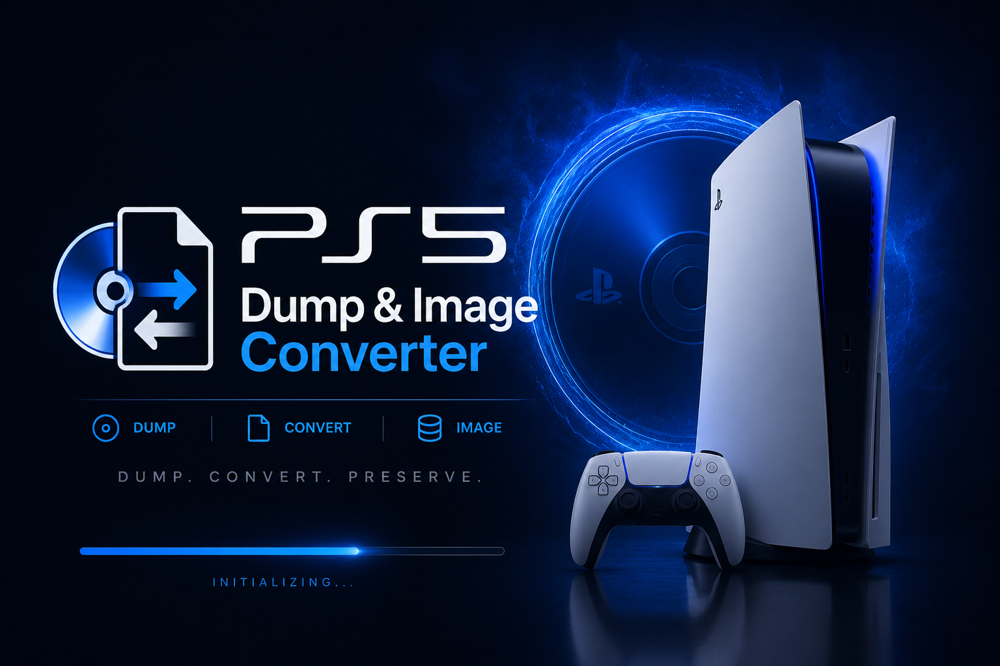
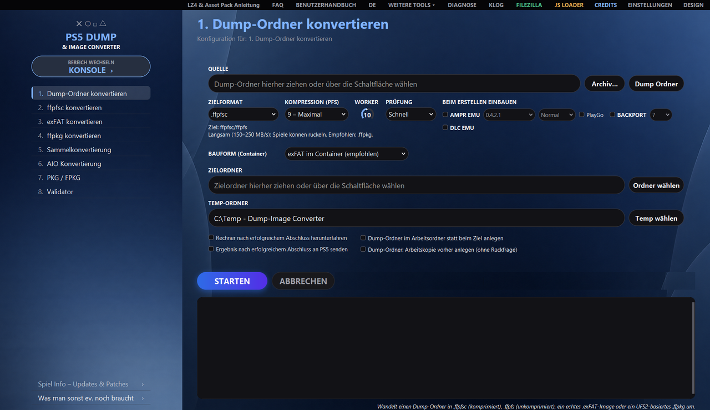
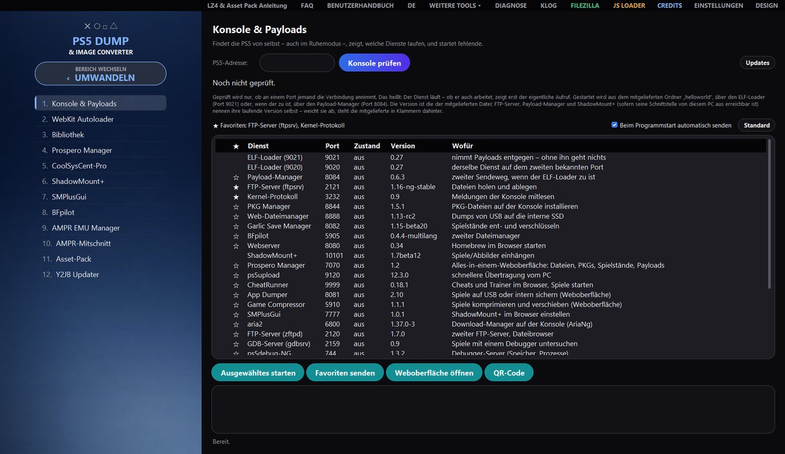
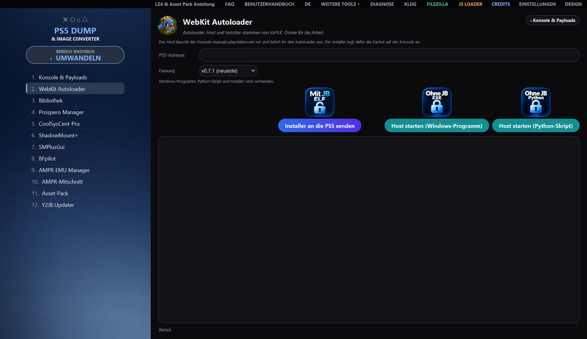
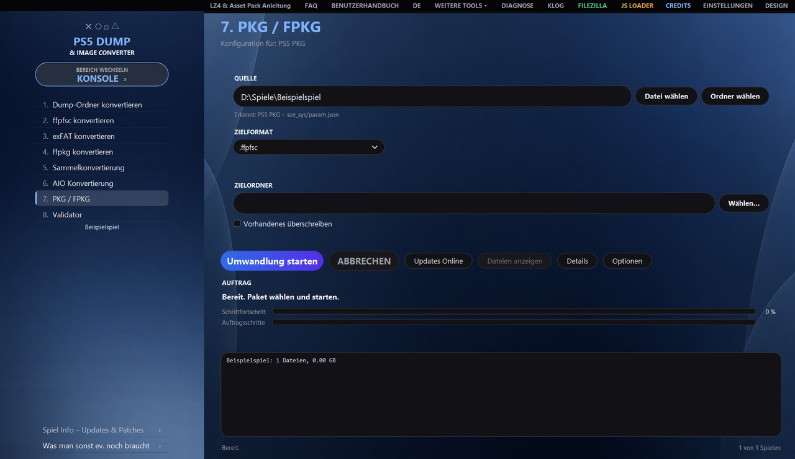
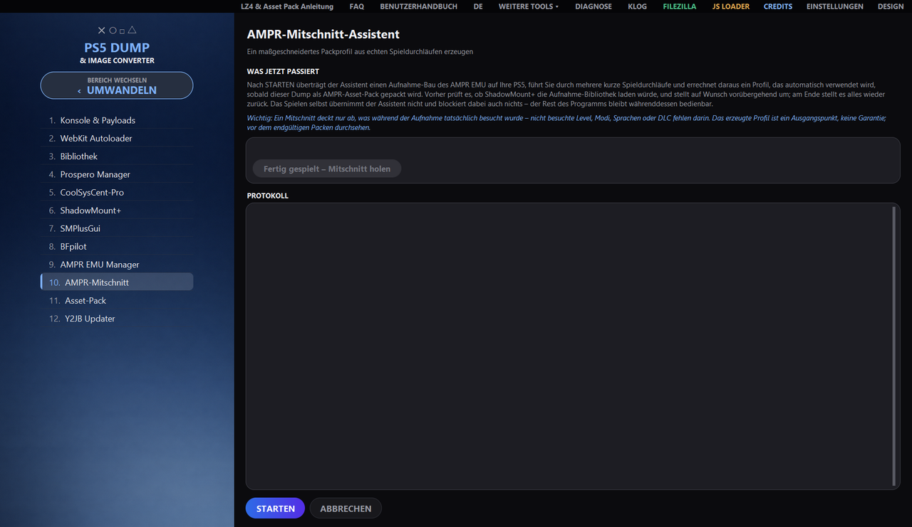

<div align="center">



# PS5 Dump & Image Converter

**Convertir, extraire et vérifier des dumps et des images PS5, créer des paquets PS4 et PS5
et piloter la console en même temps – sous Windows, Linux et macOS.**


[Fonctionnalités](#fonctionnalités) ·
[Vues](#vues) ·
[Téléchargement](#téléchargement) ·
[Prérequis](#prérequis) ·
[Utilisation](#utilisation) ·
[Documentation](#documentation) ·
[Mentions légales](#mentions-légales) ·
[Crédits](#crédits)



</div>

**Deutsch: [README.md](README.md) · English: [README_EN.md](README_EN.md) · Español: [README_ES.md](README_ES.md) · Italiano: [README_IT.md](README_IT.md) · Français: [README_FR.md](README_FR.md)**

Cette version est une traduction de la [README.md](README.md) allemande ; en cas de doute, la version allemande fait foi (mentions légales et clause de non-responsabilité comprises).

Le programme convertit les uns vers les autres les dossiers de dump, les fichiers `.ffpfsc`, `.exfat` et les
véritables fichiers `.ffpkg` basés sur UFS2, lit et crée des paquets PS4 et PS5, intègre AMPR EMU et BACKPORT
et fournit des outils pour la console : envoyer des payloads, ouvrir des interfaces web dans le programme,
gérer la bibliothèque de jeux de la PS5. Tout passe par une interface graphique à deux zones – **CONVERTIR**
et **CONSOLE** ; chaque tâche est aussi disponible sans fenêtre, en ligne de commande.

> [!IMPORTANT]
> Uniquement pour des contenus **personnels et acquis légalement**. Le piratage et le contournement des
> protections contre la copie ne sont expressément pas le but de ce projet – voir la
> [clause de non-responsabilité](#clause-de-non-responsabilité).

## Fonctionnalités

<table>
<tr>
<td width="33%" valign="top">

🔄 **Convertir**<br>
Dossiers de dump, `.ffpfsc`, `.exfat` et véritables `.ffpkg` UFS2 dans toutes les directions, y compris
directement depuis `.zip`, `.7z` et `.rar`. Seuls les formats cibles compatibles avec la source détectée sont proposés.

</td>
<td width="33%" valign="top">

🗃 **Lots et export**<br>
Conversion par lots de plusieurs conteneurs et conversion AIO de dossiers ou de conteneurs vers un
format cible adapté.

</td>
<td width="33%" valign="top">

✅ **Validateur**<br>
Rapport d'intégrité pour les dossiers de dump et les conteneurs – avant que quoi que ce soit n'atterrisse sur la console.

</td>
</tr>
<tr>
<td valign="top">

📦 **PKG / FPKG**<br>
Lire et extraire des paquets PS4 et PS5, les convertir en images, télécharger les mises à jour et les envoyer à la console.

</td>
<td valign="top">

🧩 **AMPR EMU et BACKPORT**<br>
Intégration lors de la création, avec des Asset Packs (LZ4, et pour AMPR EMU NG aussi zstd avec des règles TOML propres). Des profils de packaging testés sont fournis pour ASTRO BOT, EA Sports UFC 6 ainsi que pour les jeux Unity et
Insomniac.

</td>
<td valign="top">

🎯 **Enregistrement AMPR**<br>
L'assistant génère un profil de packaging sur mesure à partir de vraies parties jouées sur la PS5.

</td>
</tr>
<tr>
<td valign="top">

🎮 **Console et payloads**<br>
Trouver la PS5 sur le réseau, vérifier les services, envoyer des payloads ; les favoris peuvent, si vous le souhaitez, être
envoyés automatiquement au démarrage du programme.

</td>
<td valign="top">

🌐 **Interfaces web et Autoloader**<br>
Ouvrir les interfaces web de la console directement dans le programme ; WebKit Autoloader de itsPLK avec choix de la version.

</td>
<td valign="top">

📚 **Bibliothèque et infos de jeu**<br>
Bibliothèque de jeux de l'ordinateur et de la PS5 avec jaquette ; infos de jeu avec mises à jour et correctifs pour chaque titre.

</td>
</tr>
<tr>
<td valign="top">

🛠 **Outils**<br>
ShadowMount+, SMPlusGui, Prospero Manager, CoolSysCent-Pro, BFpilot, Asset Pack (vérifier et extraire)
et le Y2JB Updater sont accessibles depuis la
barre latérale. Sous AUTRES OUTILS, MODIFIER L'IMAGE modifie des fichiers individuels d'une image
(extraire, remplacer, renommer, supprimer, reconditionner).

</td>
<td valign="top">

⌨ **Ligne de commande**<br>
Chaque tâche aussi sans fenêtre (`--cli`), plus la vérification de l'environnement (`--doktor`) et la maintenance des outils.

</td>
<td valign="top">

🖥 **Windows, Linux, macOS**<br>
La même interface et les mêmes tâches sur les trois systèmes ; allemand, anglais, espagnol, italien et français.

</td>
</tr>
</table>

## Vues

<table>
<tr>
<td width="50%"></td>
<td width="50%"></td>
</tr>
<tr>
<td align="center">Console et payloads : vérifier les services, envoyer des payloads et des favoris</td>
<td align="center">WebKit Autoloader : envoyer l'installateur, démarrer l'hôte</td>
</tr>
<tr>
<td width="50%"></td>
<td width="50%"></td>
</tr>
<tr>
<td align="center">PKG / FPKG : lire et créer des paquets, télécharger les mises à jour</td>
<td align="center">Enregistrement AMPR : profil de packaging à partir de vraies parties jouées</td>
</tr>
</table>

## Téléchargement

Les programmes prêts à l'emploi se trouvent sous
**[Releases](https://github.com/strongt1me/PS5-Dump-Image-Converter/releases/latest)** :

| Système | Fichier | Lancement |
| --- | --- | --- |
| 🪟 Windows 10/11 | `PS5_Dump_Image_Converter_vX.Y.Z.exe` | double-clic |
| 🐧 Linux | `PS5_Dump_Image_Converter_vX.Y.Z_linux_x86_64` | `chmod +x` une fois, puis lancer |
| 🍎 macOS (Apple Silicon) | `…_macos_arm64.dmg` | `Erste Installation.command` dans l'image |
| 🍎 macOS (Intel) | `…_macos_x86_64.dmg` | `Erste Installation.command` dans l'image |

Sous macOS, `Erste Installation.command` place l'application au bon endroit et retire le marquage de quarantaine.

## Prérequis

- **Windows 10/11**, une distribution Linux récente ou **macOS** (testé sous macOS 15 ; les versions antérieures n'ont pas été testées)
- Suffisamment d'espace disque libre pour la source, l'état intermédiaire et la sortie
- **Windows :** droits d'administrateur pour les opérations UFS2 (`.ffpkg`)
- **OSFMount non requis :** le programme lit les images `.exFAT` avec son lecteur exFAT intégré, sans
  rien monter – sur tous les systèmes. [OSFMount](https://www.osforensics.com/tools/mount-disk-images.html)
  n'est qu'un recours pour les images inhabituelles sous Windows ; s'il est nécessaire, le programme le signale
  et peut l'installer lui-même
- **À partir du code source :** Python 3.11+ et `pip`

## Utilisation

La barre latérale comporte deux zones, entre lesquelles le bouton **CHANGER DE ZONE** permet de basculer.

<table>
<tr>
<th width="50%">CONVERTIR</th>
<th width="50%">CONSOLE</th>
</tr>
<tr>
<td valign="top">

| N° | Tâche |
| ---: | --- |
| 1 | Convertir le dossier dump |
| 2 | Convertir ffpfsc |
| 3 | Convertir exFAT |
| 4 | Convertir ffpkg |
| 5 | Conversion par lots |
| 6 | Conversion AIO |
| 7 | PKG / FPKG |
| 8 | Validateur |

</td>
<td valign="top">

| N° | Outil |
| ---: | --- |
| 1 | Console et payloads |
| 2 | WebKit Autoloader |
| 3 | Bibliothèque |
| 4 | Prospero Manager |
| 5 | CoolSysCent-Pro |
| 6 | ShadowMount+ |
| 7 | SMPlusGui |
| 8 | BFpilot |
| 9 | AMPR EMU Manager |
| 10 | Enregistrement AMPR |
| 11 | Asset Pack |
| 12 | Y2JB Updater |

</td>
</tr>
</table>

Le **[manuel utilisateur](BENUTZERHANDBUCH_FR.html)** explique en détail ce que fait chaque bouton ; des réponses brèves
se trouvent dans la **[FAQ](FAQ_FR.html)**. Dans le programme, les boutons **MANUEL UTILISATEUR** et **FAQ**
en haut de la barre de titre ouvrent les deux, dans la langue de l'interface.

## Documentation

| Document | Contenu | Formats |
| --- | --- | --- |
| **Manuel utilisateur** | utilisation en langage simple : toutes les tâches, la barre d'outils, erreurs typiques, particularités sous Linux et macOS | [HTML](BENUTZERHANDBUCH_FR.html) · [PDF](BENUTZERHANDBUCH_FR.pdf) |
| **FAQ (allemand)** | les questions les plus fréquentes, avec des réponses brèves | [HTML](FAQ.html) · [PDF](FAQ.pdf) |
| **FAQ (anglais)** | les questions les plus fréquentes, avec des réponses brèves | [HTML](FAQ_EN.html) · [PDF](FAQ_EN.pdf) |
| **FAQ (espagnol)** | les questions les plus fréquentes, avec des réponses brèves | [HTML](FAQ_ES.html) · [PDF](FAQ_ES.pdf) |
| **FAQ (italien)** | les questions les plus fréquentes, avec des réponses brèves | [HTML](FAQ_IT.html) · [PDF](FAQ_IT.pdf) |
| **FAQ (français)** | les questions les plus fréquentes, avec des réponses brèves | [HTML](FAQ_FR.html) · [PDF](FAQ_FR.pdf) |
| **Changelog** | ce qui a changé à chaque version | [CHANGELOG.md](CHANGELOG.md) |
| **Guides** | Asset Packs AMPR avec assistant d'enregistrement, ShadowMount+ `fakelib` | [Anleitungen/](Anleitungen) |

## Pour utilisateurs avancés

<details>
<summary><b>Ligne de commande</b> – chaque tâche sans fenêtre</summary>

<br>

Via la même logique de traitement éprouvée que l'interface :

```bash
python PS5ImageConverter_Pro_FINAL_revised.py --cli --task 1 \
  --source "D:\Dumps\Spiel" --dest "D:\Ausgabe" --format ffpkg --yes
```

| Option | Signification |
| --- | --- |
| `--cli` | active le mode ligne de commande (obligatoire) |
| `--task N` | tâche 1–8 |
| `--source CHEMIN` | chemin source ; plusieurs uniquement pour la tâche 5 |
| `--dest CHEMIN` | dossier cible (inutile pour la tâche 8) |
| `--format …` | `folder`, `ffpfsc`, `ffpfs`, `exfat`, `ffpkg` |
| `--temp CHEMIN` | remplacer le dossier de travail |
| `--yes` | confirmer automatiquement les questions |
| `--quiet` | ne pas répercuter le journal sur stdout |
| `--shutdown-on-success` | éteindre l'ordinateur après un succès |
| `--archiv-passwort MOT_DE_PASSE` | mot de passe d'une archive chiffrée comme source (tâches 1 et 5) ; sans lui, le programme essaie les mots de passe usuels |
| `--ampr-pack-verfahren` | méthode d'empaquetage de l'Asset Pack : `lz4` (par défaut) ou `zstd` (uniquement pour AMPR EMU NG) |
| `--ampr-lz4-stufe N` | niveau LZ4 de l'Asset Pack, 1–12 (par défaut 9) |
| `--ampr-zstd-stufe N` | niveau zstd de l'Asset Pack, 1–22 (par défaut 5) |
| `--dump-im-arbeitsordner` | créer le dossier de dump temporaire des voies de reconditionnement dans le dossier de travail plutôt qu'à la destination |
| `--umhuellt-neu-packen` | `.exFAT`/`.ffpkg` → `.ffpfsc` avec AMPR EMU/BACKPORT : extraire, intégrer, reconditionner en `.ffpfsc` |
| `--umhuellt-als-ordner` | par la même voie, ne construire que le dossier de dump à la place |
| `--ampr-index-trotz-assets` | reconstruire `ampr_emu.index` même si un Asset Pack est présent |
| `--ampr-originale-weglassen` | avec l'Asset Pack, retirer de la copie de travail les originaux empaquetés (judicieux uniquement après un test réussi sur la console ; avec AMPR EMU NG et zstd toujours, sans demander) |
| `--param-json-reparieren` | réparer sans confirmation un `param.json` défectueux |
| `--param-json-online` | rechercher en ligne le titre et le Content-ID correspondants |

Les six dernières décident de questions auxquelles `--yes` ne répond volontairement **pas** : un commutateur
destiné aux questions d'écrasement ne doit pas, au passage, changer de voie, rendre un Asset Pack inutilisable,
supprimer des fichiers de jeu ou envoyer des données sur le réseau.

Codes de retour : `0` succès · `1` erreur ou annulation · `2` arguments invalides · `3` droits
d'administrateur manquants · `4` non vérifié (tâche 8 sans les droits nécessaires – aucun jugement sur le fichier).

> Sous Windows, `--cli` ne demande **aucun** droit – un processus relancé serait détaché et sa
> sortie n'atteindrait jamais l'appelant. Lancez donc vous-même l'invite de commandes en tant qu'administrateur.

</details>

<details>
<summary><b>Vérification de l'environnement</b> – <code>--doktor</code></summary>

<br>

Quand quelque chose ne fonctionne pas alors que cela fonctionne ailleurs, `--doktor` passe en revue les causes fréquentes et fournit un
résultat qui peut être copié dans un message d'erreur – sans accès au réseau et sans identifiants :

```bash
python PS5ImageConverter_Pro_FINAL_revised.py --doktor "E:\Temp" "E:\Ziel"
```

Les deux indications de dossier sont facultatives. Sont vérifiés notamment les chemins longs désactivés, le
système de fichiers des dossiers (sur FAT32, chaque fichier s'arrête à 4 Go), le droit d'écriture et l'espace libre,
les versions de paquets contradictoires, si les programmes fournis peuvent seulement être lancés, et si le
fichier de paramètres est lisible.

Codes de retour : `0` rien à signaler · `1` au moins une véritable erreur. Les mêmes informations figurent dans la
fenêtre **DIAGNOSTIC**, dans la section *Docteur*.

> L'**EXE finalisé** exige par principe des droits d'administrateur – c'est indiqué dans son manifeste et cela vaut pour
> chaque appel, y compris pour `--doktor`. Ouvrez donc vous-même l'invite de commandes en tant qu'administrateur.
> À partir du code source (`python …`), la vérification s'exécute sans droits élevés.

</details>

<details>
<summary><b>Maintenance des outils</b> – <code>--werkzeuge-pruefen</code></summary>

<br>

`--werkzeuge-pruefen` compare les payloads fournis avec leurs publications :

```bash
python PS5ImageConverter_Pro_FINAL_revised.py --werkzeuge-pruefen
```

La première partie s'exécute **sans réseau** et compare uniquement le dossier `helloworld/` avec le tableau de
`THIRD_PARTY_LICENSES.md` ; elle figure aussi dans le rapport de diagnostic, dans la section *Maintenance des outils*. La seconde partie
lit une liste publique de versions – c'est le **seul** accès au réseau de cette exécution, et il n'a lieu
que parce que vous avez donné la commande. Avec `--offline`, il est omis. Codes de retour : `0` rien à faire ·
`1` écart, retard ou liste inaccessible.

</details>

<details>
<summary><b>Compiler et tester soi-même</b></summary>

<br>

```powershell
# Windows
.\Build_EXE.ps1
```

```bash
# Linux
chmod +x Build_Linux.sh && ./Build_Linux.sh

# macOS (--dmg génère en plus l'image disque)
chmod +x Build_macOS.sh && ./Build_macOS.sh --dmg
```

La suite de tests s'exécute avec un **dossier de paramètres dédié** – beaucoup de tests appuient sur de vrais boutons et
enregistrent à cette occasion, et sans redirection ces modifications finiraient dans les paramètres du programme :

```powershell
# Windows (PowerShell)
$env:PS5CONV_KONFIGORDNER = "$env:TEMP\ps5conv_pruefung\konfig"
python -m pytest -q
```

```bash
# Linux et macOS
PS5CONV_KONFIGORDNER="${TMPDIR:-/tmp}/ps5conv_pruefung/konfig" python -m pytest -q
```

Les tests se trouvent dans le dossier [`tests/`](tests), les notes de version dans [`release_notes/`](release_notes).

</details>

## Différences entre plateformes

L'interface, les huit tâches, la ligne de commande et le transfert vers la PS5 fonctionnent partout de la même façon.
Les différences se trouvent ici :

| Domaine | Linux et macOS |
| --- | --- |
| Lire et créer des `.ffpkg` | Disponible – UFS2Tool est fourni pour Windows, Linux et macOS (Intel et Apple Silicon) ; la lecture se fait via `UFS2Tool extract`, la création via `newfs`/`makefs`. Seul le montage via le pilote Dokan n'existe que sous Windows. |
| PS4 PKG Dump & Image Converter | OrbisPkgTool n'existe que comme programme Windows. Il y extrait les paquets PS4 vers le dossier de dump et fusionne base, mise à jour et DLC ; sans cet outil, il reste ffpfsc et exFAT, qui sont construits directement à partir des paquets via PS4 FFPFSC. La collection, les détails, la recherche de mises à jour et l'envoi fonctionnent partout. |
| Solutions de remplacement d'OSFMount | Non disponible ; les voies natives MkPFS/exFAT sont entièrement présentes. |
| Droits élevés | Non nécessaires. |
| Paramètres | `~/.config/PS5ImageConverterPro/` ou `~/Library/Application Support/PS5ImageConverterPro/` |
| Installation automatique d'outils tiers | Windows uniquement ; sinon FileZilla est recherché dans le `PATH`. |

## Mentions légales

### Clause de non-responsabilité

Ce projet sert à la **sauvegarde et à la gestion de contenus que vous avez acquis légalement**, ainsi qu'à des
fins pédagogiques et de recherche.

- Utilisez-le **exclusivement** avec des logiciels qui vous appartiennent.
- Le contournement de mesures de protection techniques, ainsi que l'obtention, la diffusion ou la mise à
  disposition du public de contenus protégés par le droit d'auteur ne sont **pas** le but de ce projet et ne sont pas pris en charge.
- Dans de nombreux pays, le simple contournement d'une protection contre la copie est déjà interdit – même pour ses propres supports.
  **Vérifiez la législation de votre pays.**
- L'utilisation se fait **sous votre propre responsabilité et à vos propres risques**. Les auteurs déclinent toute responsabilité
  pour les dommages, pertes de données, appareils défectueux ou conséquences juridiques.
- Les modifications apportées à une console de jeu peuvent annuler sa garantie et la rendre inutilisable.

Ce projet n'a **aucun lien avec Sony Interactive Entertainment** et n'est ni soutenu ni contrôlé par cette société.
Toutes les marques appartiennent à leurs détenteurs respectifs.

Sauvegardez séparément les fichiers originaux avant tout traitement.

### Licence

Le programme lui-même est placé depuis le 07.10.2026 sous la
[GNU General Public License, version 3 ou ultérieure (GPL-3.0-or-later)](LICENSE).
Les versions jusqu'à la v1.9.64 incluse ont été publiées sous licence MIT et restent
sous MIT pour leurs destinataires.

```
PS5 Dump & Image Converter
Copyright (C) 2026 strongt1me

This program is free software: you can redistribute it and/or modify
it under the terms of the GNU General Public License as published by
the Free Software Foundation, either version 3 of the License, or
(at your option) any later version.

This program is distributed in the hope that it will be useful,
but WITHOUT ANY WARRANTY; without even the implied warranty of
MERCHANTABILITY or FITNESS FOR A PARTICULAR PURPOSE.  See the
GNU General Public License for more details.
```

Les composants tiers fournis sont soumis à leurs propres licences, certaines assorties de conditions particulières. Elles
figurent dans [THIRD_PARTY_LICENSES.md](THIRD_PARTY_LICENSES.md) et sont directement
consultables dans la fenêtre **CRÉDITS** – à vérifier avant toute redistribution.

## Crédits

- **PSBrew / Renan Barreto** ([@RenanGBarreto](https://github.com/RenanGBarreto)) – [MkPFS](https://github.com/PSBrew/MkPFS), le moteur PFS de ce programme
- **SvenGDK et contributeurs** – [UFS2Tool](https://github.com/SvenGDK/UFS2Tool) et **LibProsperoPkg**, l'outil derrière « Lire l'en-tête du paquet » dans « PS4 PKG Dump & Image Converter »
- **pearlxcore** – [OrbisPkgTool](https://github.com/pearlxcore/OrbisPkgTool) (MIT), le moteur derrière « PS4 PKG Dump & Image Converter » ; l'idée de la fenêtre vient de PS4 PKG Tool, dont aucun code n'a été repris
- **PS4 FFPFSC** – paquets PS4 vers `.ffpfsc` (GPL-3.0-or-later)
- **andy-man** – [PS5 Wee Tools](https://github.com/andy-man/ps5-wee-tools), outil pour la mémoire flash NOR de la console (GPL-3.0), sous AUTRES OUTILS
- **kerrdec97** – [ps5-exfat-builder](https://github.com/kerrdec97/ps5-exfat-builder), travaux préparatoires et source d'inspiration
- **drakmor / Roman Tarasov** – [AMPR EMU](https://github.com/drakmor/ampr_emu) et les **AMPR PackTools** (GPL-3.0), base des Asset Packs
- **danthespal** – [MkPFS.CSharp](https://github.com/danthespal/MkPFS.CSharp) (GPL-3.0), les profils de packaging testés pour ASTRO BOT, EA Sports UFC 6 et les jeux Unity et Insomniac
- **libScePlayGo-Stub** – communauté homebrew PS5, signale les contenus PlayGo comme installés
- **John Törnblom** – [PS5 Payload SDK](https://github.com/ps5-payload-dev/sdk) ; `appinst.elf`, derrière « Installer l'app directement », est dérivé de son exemple (GPL-3.0)
- **PS5 BackPork Kitchen**, **BestPig**, **idlesauce**, **John Törnblom**, **CyB1K** – méthodes et modèles pour BACKPORT
- **PassMark Software** – OSFMount
- **Projet Dokan** – pilote de système de fichiers Windows
- **Projet PyInstaller** – regroupement du programme

Les remerciements complets – avec image, travaux et liens GitHub des développeuses et développeurs, y compris ceux des
payloads fournis et de nombreuses figures connues de la communauté – figurent dans la fenêtre **CRÉDITS** et dans
[THIRD_PARTY_LICENSES.md](THIRD_PARTY_LICENSES.md).

La fonction **BACKPORT** s'appuie sur des méthodes développées et publiées au sein de la scène.
