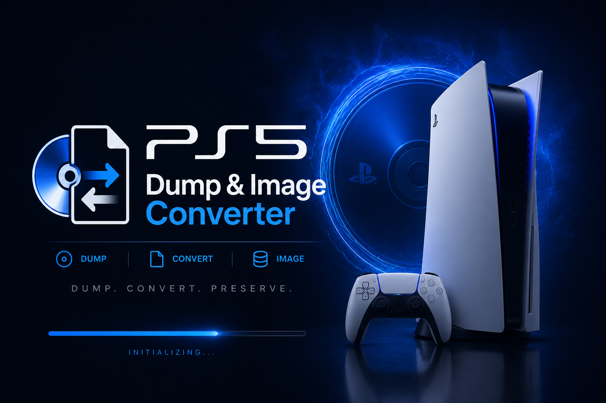
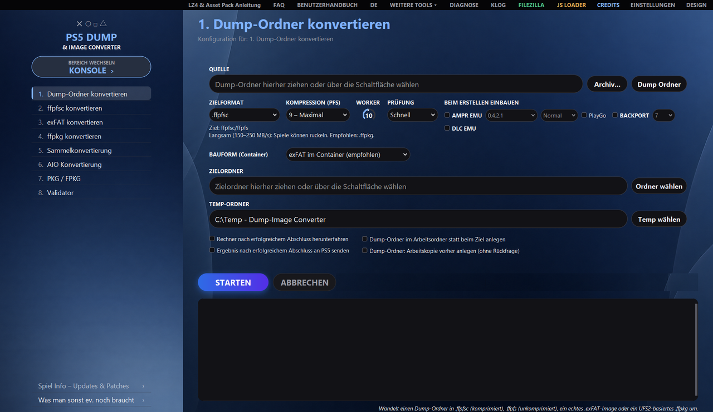
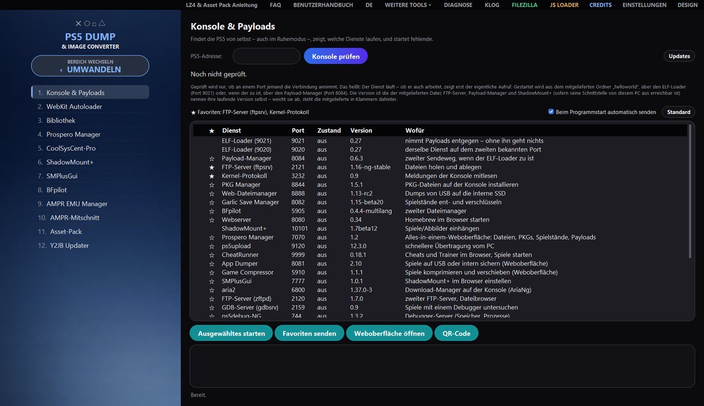
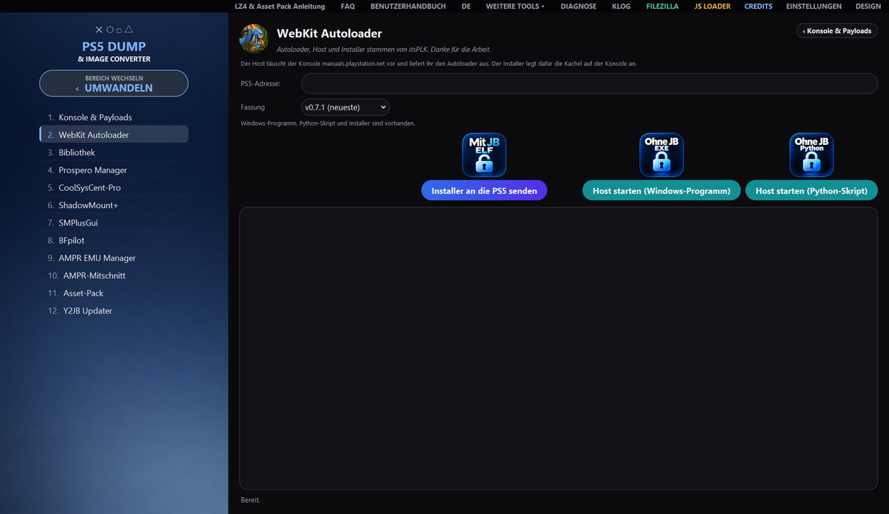
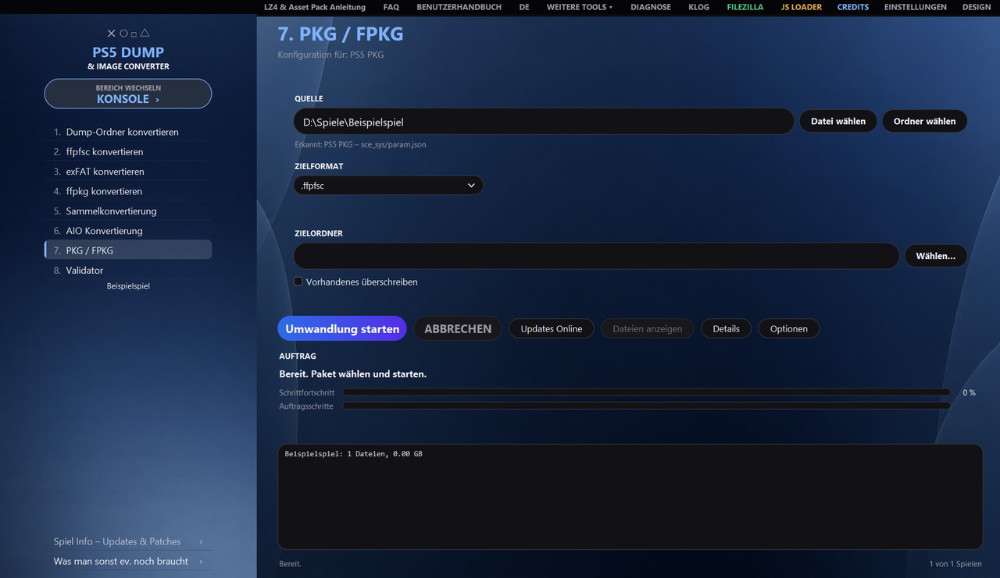
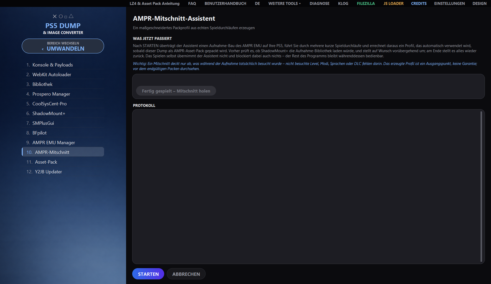

<div align="center">



# PS5 Dump & Image Converter

**Convertire, estrarre e verificare dump e immagini PS5, creare pacchetti PS4 e PS5
e usare la console direttamente dal programma – su Windows, Linux e macOS.**


[Funzionalità](#funzionalità) ·
[Viste](#viste) ·
[Download](#download) ·
[Requisiti](#requisiti) ·
[Utilizzo](#utilizzo) ·
[Documentazione](#documentazione) ·
[Note legali](#note-legali) ·
[Crediti](#crediti)



</div>

**Deutsch: [README.md](README.md) · English: [README_EN.md](README_EN.md) · Español: [README_ES.md](README_ES.md) · Italiano: [README_IT.md](README_IT.md) · Français: [README_FR.md](README_FR.md)**

Questa versione è una traduzione del file README.md tedesco; in caso di dubbio fa fede la versione tedesca (note legali ed esclusione di responsabilità incluse).

Il programma converte tra loro cartelle dump, `.ffpfsc`, `.exfat` e veri file `.ffpkg` basati su UFS2,
legge e crea pacchetti PS4 e PS5, integra AMPR EMU e BACKPORT e include strumenti per la console: invio
di payload, apertura delle interfacce web direttamente nel programma, gestione della libreria giochi
della PS5. Tutto avviene tramite un'interfaccia grafica con due aree – **CONVERTI** e
**CONSOLE**; ogni attività è disponibile anche senza finestra, da riga di comando.

> [!IMPORTANT]
> Solo per contenuti **propri e acquistati legittimamente**. La pirateria e l'elusione della protezione
> anticopia non sono espressamente lo scopo di questo progetto – vedere [Esclusione di responsabilità](#esclusione-di-responsabilità).

## Funzionalità

<table>
<tr>
<td width="33%" valign="top">

🔄 **Conversione**<br>
Cartelle dump, `.ffpfsc`, `.exfat` e veri `.ffpkg` UFS2 in ogni direzione, anche direttamente da
`.zip`, `.7z` e `.rar`. Vengono proposti solo i formati di destinazione compatibili con l'origine rilevata.

</td>
<td width="33%" valign="top">

🗃 **Raccolta ed esportazione**<br>
Conversione collettiva di più contenitori e conversione AIO per cartelle o contenitori in un
formato di destinazione adatto.

</td>
<td width="33%" valign="top">

✅ **Validatore**<br>
Rapporto di integrità per cartelle dump e contenitori – prima che qualcosa venga trasferito sulla console.

</td>
</tr>
<tr>
<td valign="top">

📦 **PKG / FPKG**<br>
Leggere ed estrarre pacchetti PS4 e PS5, crearne immagini, scaricare aggiornamenti e inviarli alla console.

</td>
<td valign="top">

🧩 **AMPR EMU & BACKPORT**<br>
Integrazione in fase di creazione, con Asset Pack (LZ4, per AMPR EMU NG anche zstd con regole TOML proprie). Per ASTRO BOT, EA Sports UFC 6 e per i giochi Unity e
Insomniac sono inclusi profili di pacchetto testati.

</td>
<td valign="top">

🎯 **Registrazione AMPR**<br>
La procedura guidata genera, da sessioni di gioco reali sulla PS5, un profilo di pacchetto su misura.

</td>
</tr>
<tr>
<td valign="top">

🎮 **Console e payload**<br>
Trovare la PS5 in rete, verificare i servizi, inviare payload; su richiesta i preferiti vengono inviati
automaticamente all'avvio del programma.

</td>
<td valign="top">

🌐 **Interfacce web e Autoloader**<br>
Aprire le interfacce web della console direttamente nel programma; WebKit Autoloader di itsPLK con scelta della versione.

</td>
<td valign="top">

📚 **Libreria e Info gioco**<br>
Libreria giochi del computer e della PS5 con copertina; Info gioco con aggiornamenti e patch per ogni titolo.

</td>
</tr>
<tr>
<td valign="top">

🛠 **Strumenti**<br>
ShadowMount+, SMPlusGui, Prospero Manager, CoolSysCent-Pro e BFpilot sono raggiungibili dalla
barra laterale. Sotto ALTRI STRUMENTI, MODIFICA IMMAGINE modifica singoli file di un'immagine
(estrarre, sostituire, rinominare, eliminare, ricreare il pacchetto).

</td>
<td valign="top">

⌨ **Riga di comando**<br>
Ogni attività anche senza finestra (`--cli`), inoltre controllo dell'ambiente (`--doktor`) e manutenzione degli strumenti.

</td>
<td valign="top">

🖥 **Windows, Linux, macOS**<br>
La stessa interfaccia e le stesse attività su tutti e tre i sistemi; tedesco, inglese, spagnolo, italiano e francese.

</td>
</tr>
</table>

## Viste

<table>
<tr>
<td width="50%"></td>
<td width="50%"></td>
</tr>
<tr>
<td align="center">Console e payload: verificare i servizi, inviare payload e preferiti</td>
<td align="center">WebKit Autoloader: inviare l'installer, avviare l'host</td>
</tr>
<tr>
<td width="50%"></td>
<td width="50%"></td>
</tr>
<tr>
<td align="center">PKG / FPKG: leggere e creare pacchetti, scaricare aggiornamenti</td>
<td align="center">Registrazione AMPR: profilo di pacchetto da sessioni di gioco reali</td>
</tr>
</table>

## Download

I programmi già pronti si trovano in
**[Releases](https://github.com/strongt1me/PS5-Dump-Image-Converter/releases/latest)**:

| Sistema | File | Avvio |
| --- | --- | --- |
| 🪟 Windows 10/11 | `PS5_Dump_Image_Converter_vX.Y.Z.exe` | doppio clic |
| 🐧 Linux | `PS5_Dump_Image_Converter_vX.Y.Z_linux_x86_64` | una volta `chmod +x`, poi avviare |
| 🍎 macOS (Apple Silicon) | `…_macos_arm64.dmg` | `Erste Installation.command` nell'immagine |
| 🍎 macOS (Intel) | `…_macos_x86_64.dmg` | `Erste Installation.command` nell'immagine |

Su macOS, `Erste Installation.command` copia l'app nella posizione prevista e rimuove il contrassegno di quarantena.

## Requisiti

- **Windows 10/11**, una distribuzione Linux recente oppure **macOS 12+**
- Spazio libero sufficiente per origine, stato intermedio e output
- **Windows:** privilegi di amministratore per le procedure UFS2 (`.ffpkg`)
- **OSFMount non necessario:** le immagini `.exFAT` vengono lette dal programma con il proprio lettore exFAT
  integrato, senza montare nulla – su qualsiasi sistema. [OSFMount](https://www.osforensics.com/tools/mount-disk-images.html)
  è solo la soluzione di ripiego per immagini insolite su Windows; se serve, il programma lo segnala
  e può installarlo autonomamente
- **Dal codice sorgente:** Python 3.11+ e `pip`

## Utilizzo

La barra laterale ha due aree, tra le quali si passa con il pulsante **CAMBIA AREA**.

<table>
<tr>
<th width="50%">CONVERTI</th>
<th width="50%">CONSOLE</th>
</tr>
<tr>
<td valign="top">

| N. | Attività |
| ---: | --- |
| 1 | Convertire cartella dump |
| 2 | Convertire ffpfsc |
| 3 | Convertire exFAT |
| 4 | Convertire ffpkg |
| 5 | Conversione collettiva |
| 6 | Conversione AIO |
| 7 | PKG / FPKG |
| 8 | Validatore |

</td>
<td valign="top">

| N. | Strumento |
| ---: | --- |
| 1 | Console e payload |
| 2 | WebKit Autoloader |
| 3 | Libreria |
| 4 | Prospero Manager |
| 5 | CoolSysCent-Pro |
| 6 | ShadowMount+ |
| 7 | SMPlusGui |
| 8 | BFpilot |
| 9 | AMPR EMU Manager |
| 10 | Registrazione AMPR |

</td>
</tr>
</table>

La funzione esatta di ogni pulsante è spiegata nel **[Manuale utente](BENUTZERHANDBUCH_IT.html)**; risposte
brevi si trovano nelle **[FAQ](FAQ_IT.html)**. Nel programma entrambi si aprono con i pulsanti **MANUALE UTENTE** e **FAQ**
nella barra del titolo, nella lingua dell'interfaccia.

## Documentazione

| Documento | Contenuto | Formati |
| --- | --- | --- |
| **Manuale utente** | Utilizzo in linguaggio semplice: tutte le attività, la barra degli strumenti, errori tipici, particolarità su Linux e macOS | [HTML](BENUTZERHANDBUCH_IT.html) · [PDF](BENUTZERHANDBUCH_IT.pdf) |
| **FAQ (Tedesco)** | le domande più frequenti, con risposte brevi | [HTML](FAQ.html) · [PDF](FAQ.pdf) |
| **FAQ (Inglese)** | le domande più frequenti, con risposte brevi | [HTML](FAQ_EN.html) · [PDF](FAQ_EN.pdf) |
| **FAQ (Spagnolo)** | le domande più frequenti, con risposte brevi | [HTML](FAQ_ES.html) · [PDF](FAQ_ES.pdf) |
| **FAQ (Italiano)** | le domande più frequenti, con risposte brevi | [HTML](FAQ_IT.html) · [PDF](FAQ_IT.pdf) |
| **FAQ (Francese)** | le domande più frequenti, con risposte brevi | [HTML](FAQ_FR.html) · [PDF](FAQ_FR.pdf) |
| **Changelog** | cosa è cambiato in ogni versione | [CHANGELOG.md](CHANGELOG.md) |
| **Guide** | AMPR Asset Pack con procedura guidata di registrazione, ShadowMount+ `fakelib` | [Anleitungen/](Anleitungen) |

## Per utenti avanzati

<details>
<summary><b>Riga di comando</b> – ogni attività senza finestra</summary>

<br>

Tramite la stessa logica di esecuzione verificata dell'interfaccia:

```bash
python PS5ImageConverter_Pro_FINAL_revised.py --cli --task 1 \
  --source "D:\Dumps\Spiel" --dest "D:\Ausgabe" --format ffpkg --yes
```

| Opzione | Significato |
| --- | --- |
| `--cli` | attiva la modalità a riga di comando (obbligatoria) |
| `--task N` | attività 1–8 |
| `--source PFAD` | percorso di origine; più percorsi solo per l'attività 5 |
| `--dest PFAD` | cartella di destinazione (non prevista per l'attività 8) |
| `--format …` | `folder`, `ffpfsc`, `ffpfs`, `exfat`, `ffpkg` |
| `--temp PFAD` | sostituire la cartella di lavoro |
| `--yes` | confermare automaticamente le richieste |
| `--quiet` | non riportare il registro su stdout |
| `--shutdown-on-success` | spegnere dopo il completamento con successo |
| `--umhuellt-neu-packen` | `.exFAT`/`.ffpkg` → `.ffpfsc` con AMPR EMU/BACKPORT: estrarre, integrare, ricreare il pacchetto `.ffpfsc` |
| `--umhuellt-als-ordner` | seguendo lo stesso percorso, creare invece solo la cartella dump |
| `--ampr-index-trotz-assets` | ricreare `ampr_emu.index` anche se è già presente un Asset Pack |
| `--ampr-originale-weglassen` | con l'Asset Pack, rimuovere dalla copia di lavoro gli originali impacchettati (ha senso solo dopo un test sulla console superato) |
| `--param-json-reparieren` | riparare senza richiesta un `param.json` difettoso |
| `--param-json-online` | cercare in rete titolo e Content ID a tale scopo |

Le ultime sei decidono richieste a cui `--yes` volutamente **non** risponde: un'opzione per le richieste di
sovrascrittura non deve cambiare percorso di nascosto, rendere inutilizzabile un Asset Pack,
rimuovere file di gioco o inviare dati in rete.

Codici di uscita: `0` successo · `1` errore o interruzione · `2` argomenti non validi · `3` privilegi di
amministratore mancanti · `4` non verificato (attività 8 senza i privilegi necessari – nessun giudizio sul file).

> Su Windows `--cli` **non** richiede privilegi – un processo riavviato sarebbe scollegato e il suo
> output non raggiungerebbe mai il chiamante. Avviare quindi il prompt dei comandi direttamente come amministratore.

</details>

<details>
<summary><b>Controllo dell'ambiente</b> – <code>--doktor</code></summary>

<br>

Se qualcosa non funziona, benché funzioni altrove, `--doktor` passa in rassegna le cause più comuni e fornisce un
risultato copiabile in un messaggio di errore – senza accesso alla rete e senza credenziali:

```bash
python PS5ImageConverter_Pro_FINAL_revised.py --doktor "E:\Temp" "E:\Ziel"
```

Entrambe le indicazioni di cartella sono facoltative. Vengono controllati, tra l'altro, i percorsi lunghi
disattivati, il file system delle cartelle (su FAT32 ogni file termina a 4 GB), i permessi di scrittura e lo spazio libero,
stati dei pacchetti in conflitto, se i programmi inclusi si avviano effettivamente, e se il
file delle impostazioni è leggibile.

Codici di uscita: `0` nulla da segnalare · `1` almeno un errore effettivo. Le stesse informazioni si trovano nella
finestra **DIAGNOSTICA** nella sezione *Doctor*.

> L'**EXE finale** richiede per principio privilegi di amministratore – è indicato nel suo manifest e vale per
> ogni chiamata, anche per `--doktor`. Aprire quindi il prompt dei comandi direttamente come amministratore.
> Dal codice sorgente (`python …`) il controllo viene eseguito senza privilegi elevati.

</details>

<details>
<summary><b>Manutenzione degli strumenti</b> – <code>--werkzeuge-pruefen</code></summary>

<br>

`--werkzeuge-pruefen` confronta i payload inclusi con le rispettive pubblicazioni:

```bash
python PS5ImageConverter_Pro_FINAL_revised.py --werkzeuge-pruefen
```

La prima parte viene eseguita **senza rete** e confronta solo la cartella `helloworld/` con la tabella in
`THIRD_PARTY_LICENSES.md`; è presente anche nel rapporto di diagnostica nella sezione *Manutenzione strumenti*. La seconda parte
legge un elenco pubblico delle versioni – è l'**unico** accesso alla rete di questa esecuzione, e avviene
solo perché il comando è stato impartito. Con `--offline` viene omesso. Codici di uscita: `0` nulla da fare ·
`1` discrepanza, arretrato o elenco non raggiungibile.

</details>

<details>
<summary><b>Compilare ed eseguire i test in autonomia</b></summary>

<br>

```powershell
# Windows
.\Build_EXE.ps1
```

```bash
# Linux
chmod +x Build_Linux.sh && ./Build_Linux.sh

# macOS (--dmg crea in aggiunta l'immagine)
chmod +x Build_macOS.sh && ./Build_macOS.sh --dmg
```

La serie di test viene eseguita con una **cartella delle impostazioni propria** – molti test premono pulsanti reali e
salvano, e senza deviazione queste modifiche finirebbero nelle impostazioni del programma:

```powershell
# Windows (PowerShell)
$env:PS5CONV_KONFIGORDNER = "$env:TEMP\ps5conv_pruefung\konfig"
python -m pytest -q
```

```bash
# Linux e macOS
PS5CONV_KONFIGORDNER="${TMPDIR:-/tmp}/ps5conv_pruefung/konfig" python -m pytest -q
```

I test si trovano nella cartella [`tests/`](tests), le Release Notes in [`release_notes/`](release_notes).

</details>

## Differenze tra le piattaforme

Interfaccia, tutte e otto le attività, riga di comando e trasferimento alla PS5 funzionano ovunque allo stesso modo.
Le differenze sono queste:

| Ambito | Linux e macOS |
| --- | --- |
| Lettura e creazione di `.ffpkg` | Disponibile – UFS2Tool è incluso per Windows, Linux e macOS (Intel e Apple Silicon); la lettura avviene tramite `UFS2Tool extract`, la creazione tramite `newfs`/`makefs`. Solo il montaggio tramite il driver Dokan esiste esclusivamente su Windows. |
| PS4 PKG Dump & Image Converter | OrbisPkgTool esiste solo come programma Windows. Lì estrae i pacchetti PS4 nella cartella dump e unisce base, aggiornamento e DLC; senza lo strumento restano ffpfsc ed exFAT, creati direttamente dai pacchetti tramite PS4 FFPFSC. Raccolta, dettagli, richiesta degli aggiornamenti e invio funzionano ovunque. |
| Alternative a OSFMount | Non disponibili; i percorsi nativi MkPFS/exFAT sono presenti per intero. |
| Privilegi elevati | Non necessari. |
| Impostazioni | `~/.config/PS5ImageConverterPro/` ovvero `~/Library/Application Support/PS5ImageConverterPro/` |
| Installazione automatica di strumenti di terze parti | Solo Windows; altrimenti FileZilla viene cercato nel `PATH`. |

## Note legali

### Esclusione di responsabilità

Questo progetto serve a **salvare e gestire contenuti acquisiti legittimamente**, nonché a
scopi didattici e di ricerca.

- Utilizzarlo **esclusivamente** con software di propria proprietà.
- L'elusione di misure tecniche di protezione, l'acquisizione, la diffusione o la messa a disposizione del pubblico
  di contenuti protetti da diritto d'autore **non** è lo scopo di questo progetto e non è supportata.
- In molti paesi è già vietata l'elusione di una protezione anticopia – anche per supporti propri.
  **Verificare la situazione giuridica nel proprio paese.**
- L'utilizzo avviene a **proprio rischio e sotto la propria responsabilità**. Gli autori non si assumono alcuna responsabilità
  per danni, perdita di dati, dispositivi difettosi o conseguenze legali.
- Le modifiche a una console di gioco possono far decadere la garanzia e renderla inutilizzabile.

Questo progetto **non ha alcun legame con Sony Interactive Entertainment** e non è né
supportato né verificato da tale società. Tutti i marchi appartengono ai rispettivi titolari.

Prima di qualsiasi elaborazione, salvare separatamente i file originali.

### Licenza

Il programma stesso è rilasciato dal 7 ottobre 2026 sotto la
[GNU General Public License, versione 3 o successiva (GPL-3.0-or-later)](LICENSE).
Le versioni fino alla v1.9.64 inclusa sono state pubblicate sotto licenza MIT e restano per i
rispettivi destinatari sotto MIT.

```
PS5 Dump & Image Converter
Copyright (C) 2026 strongt1me

This program is free software: you can redistribute it and/or modify
it under the terms of the GNU General Public License as published by
the Free Software Foundation, either version 3 of the License, or
(at your option) any later version.

This program is distributed in the hope that it will be useful,
but WITHOUT ANY WARRANTY; without even the implied warranty of
MERCHANTABILITY or FITNESS FOR A PARTICULAR PURPOSE.  See the
GNU General Public License for more details.
```

Per i componenti di terze parti inclusi valgono le rispettive licenze, alcune con condizioni proprie. Si
trovano in [THIRD_PARTY_LICENSES.md](THIRD_PARTY_LICENSES.md) e sono consultabili direttamente nella finestra **CREDITI** –
da verificare prima di una ridistribuzione.

## Crediti

- **PSBrew / Renan Barreto** ([@RenanGBarreto](https://github.com/RenanGBarreto)) – [MkPFS](https://github.com/PSBrew/MkPFS), il motore PFS di questo programma
- **SvenGDK e collaboratori** – [UFS2Tool](https://github.com/SvenGDK/UFS2Tool) e **LibProsperoPkg**, lo strumento alla base di “Leggi intestazione pacchetto” in “PS4 PKG Dump & Image Converter”
- **pearlxcore** – [OrbisPkgTool](https://github.com/pearlxcore/OrbisPkgTool) (MIT), il motore alla base di “PS4 PKG Dump & Image Converter”; lo spunto per la finestra è venuto da PS4 PKG Tool, del cui codice non è stato ripreso nulla
- **PS4 FFPFSC** – pacchetti PS4 verso `.ffpfsc` (GPL-3.0-or-later)
- **andy-man** – [PS5 Wee Tools](https://github.com/andy-man/ps5-wee-tools), strumento per la flash NOR della console (GPL-3.0), sotto ALTRI STRUMENTI
- **kerrdec97** – [ps5-exfat-builder](https://github.com/kerrdec97/ps5-exfat-builder), lavoro preliminare e riferimento
- **drakmor / Roman Tarasov** – [AMPR EMU](https://github.com/drakmor/ampr_emu) e gli **AMPR PackTools** (GPL-3.0), base degli Asset Pack
- **danthespal** – [MkPFS.CSharp](https://github.com/danthespal/MkPFS.CSharp) (GPL-3.0), i profili di pacchetto testati per ASTRO BOT, EA Sports UFC 6 e i giochi Unity e Insomniac
- **libScePlayGo-Stub** – community homebrew PS5, segnala i contenuti PlayGo come installati
- **John Törnblom** – [PS5 Payload SDK](https://github.com/ps5-payload-dev/sdk); `appinst.elf`, alla base di “Installa app direttamente”, deriva dal suo esempio (GPL-3.0)
- **PS5 BackPork Kitchen**, **BestPig**, **idlesauce**, **John Törnblom**, **CyB1K** – procedure e modelli per BACKPORT
- **PassMark Software** – OSFMount
- **Progetto Dokan** – driver di file system per Windows
- **Progetto PyInstaller** – creazione del pacchetto del programma

Il ringraziamento completo – con immagine, opere e link GitHub degli sviluppatori e delle sviluppatrici, anche dei
payload inclusi e di molti volti noti della community – si trova nella finestra **CREDITI** e in
[THIRD_PARTY_LICENSES.md](THIRD_PARTY_LICENSES.md).

La funzione **BACKPORT** si basa su procedure sviluppate e pubblicate all'interno della scena.
